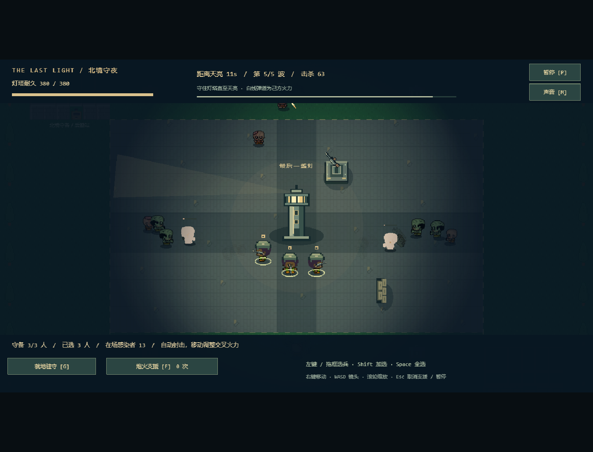

# 最后一盏灯 · The Last Light

软件工程课程项目，正在从网页面板原型重构为 Phaser 2D 末日生存 + RTS 塔防游戏。

**当前版本 v0.6：完整昼夜 + 操作与展示优化。** 亲自探索搜刮、寻找步枪和营救幸存者，返营后建设并指挥守备，再抵御三类感染者的五波尸潮，守住灯塔直到天亮。探索 **90 秒** + 布防 **30 秒** + 夜战 **120 秒**，约 4 分钟；前两段可提前结束。新增场内指南、探索目标方向/距离、战术地图、镜头回中和白天音效。



## 启动与操作

需要 Node.js 24+。

```bash
npm ci
npm run dev
```

打开终端中的本地地址直接进入城市探索，点击画面获得焦点。推荐桌面键鼠。跟随顶部目标和地图光圈：搜刮工具箱 → 拾取步枪 → 营救工程师 → 返回暖黄色信标按 E。无需等待倒计时结束。

| 操作 | 按键 |
| --- | --- |
| 移动 | WASD / 方向键 |
| 瞄准与射击 | 鼠标瞄准，按住左键射击 |
| 换弹 | R；空弹匣后自动换弹 |
| 冲刺 | 按住 Shift，消耗体力 |
| 暂停 / 继续 | Esc / P，或右上角按钮 |
| 当前阶段操作指南 | F1 / 顶栏“指南”，查看时暂停；关闭后保留原先的暂停状态 |
| 白天 / 夜战声音 | M / 声音按钮，静音偏好跨场景保留 |
| 搜刮 / 营救 / 信标回营 | 靠近目标按 E |
| 武器切换 | 1 手枪 / 2 步枪（需先找到武器箱） |
| 背包 | Tab / B，打开时暂停计时；Esc 关闭 |
| 治疗 | H，受伤且有急救包时恢复最多 50 生命 |
| 战败重试 / 成功回营后进入基地 | Enter / 按钮 |

工程师返营额外回收建材，医护员救援时治疗，教官随队加快换弹。背包负重上限 24，搜刮整箱放不下时保留原箱。无限备用弹药用于当前演示，枪械仍有弹匣、射速和换弹限制。

到 90 秒自动黄昏收队；提前回营需到信标附近按 E，等队员跟上。只有结束时距主角 150 像素内的已汇合队员计入营救。失败不会带回本轮物资。回营后写入独立 `last-light.campaign.v2` 营地存档，刷新可查看累计库存；探索中途刷新会丢失本轮进度，旧 `last-light.save.v1` 不读写。每次出发固定从手枪开始，步枪营地解锁记录暂不用于出发配装。

## 基地布防操作

回营摘要中按 Enter，消耗真实营地库存布防；也可通过 `/?mode=base` 查看已有基地。新营地只有 3 名守卫，没有免费建设物资，需要先探索带回补给。营救教官后增加 1 名守卫，工程师使每座设施少耗 1 建材。

| 操作 | 按键 |
| --- | --- |
| 建造沙袋 / 机枪塔 | 1 / 2，随后左键点击虚线区域 |
| 旋转沙袋 / 取消建造 | R / Esc 或右键 |
| 选兵 / 多选 | 左键、拖框；Shift 加选；Space 全选 |
| 编队移动 / 就地驻守 | 右键地图 / G |
| 镜头移动 / 缩放 | WASD 或方向键 / 鼠标滚轮 |
| 镜头回灯塔 / 定位 | C / 点击右上角战术地图；小地图点击不下令、不建造、不消耗支援 |
| 拆除设施 | 左键选中设施，Delete；返实际支付建材的 50% 向下取整，电力不返 |
| 完成布防并开始守夜 | Enter；30 秒后也会自动入夜 |

路障原价建材 3，机枪塔原价建材 6 + 电力 2，上限 14 座。不能重叠、封堵十字通道、压住士兵/目的地或把士兵围困。夜战士兵与机枪塔自动射击，敌人能击毁设施并杀伤部队，灯塔耐久归零即失守。

库存、阵地和指令用同一个存档原子写入。建设、拆除、下令、完成、返回探索时保存，不逐帧保存行军位置。旧 v2 存档自动补空基地，旧 v1 不读写。写失败时提示未保存，仍能继续操作。

## 夜战

普通游荡者、疾行者、重装感染者从四个入口分五波进攻，后两波更密集，总计计划 81 只，最多同时在场 48 只。持续至 120 秒且灯塔仍存活即获胜，无需清空剩余敌人；灯塔归零立即失败，同一步到达天亮也优先判失守。

| 操作 | 效果 |
| --- | --- |
| 选兵、右键、G、Space、镜头操作 | 延续布防操作，可在夜战实时调动部队形成交叉火力 |
| F，再左键落点 | 有限炮火支援，0.65 秒后范围爆炸，不伤己方；右键/Esc 取消 |
| M / 声音按钮 | 白天和夜战音效开关，首次键鼠操作后解锁；静音偏好保留 |
| P / Esc / 暂停按钮 | 暂停尸潮、部队、计时和音效；失焦自动暂停 |
| 终局 Enter | 使用入夜前阵地再次挑战；或点击返回城市开始新一轮 |

每夜自带 1 次营地支援，白天取得步枪后为 2 次，冷却 8 秒，只能打己方视野内落点。医护员名单每 8 秒给一名受伤生还守卫恢复 8 生命。备用弹药仍无限；夜间禁止施工/拆除。具备动态视野迷雾、暖色灯束、弹道/命中/爆炸、限量尸体、黎明与胜负画面、原创合成音效。

战术地图显示己方守卫、设施和当前视野内敌人，白框表示镜头范围。顶栏预告下一波时间与类型，尸潮开始时提示。F1 指南提供本阶段操作和演示建议，覆盖时不会触发下面的战斗/施工按钮；从背包或暂停状态进入指南，关闭后仍保持原状态。失焦后需主动恢复。

入夜前阵地作为本轮重试检查点；战后只保存摘要和成功次数，不把战损写回多日养成。夜战中途刷新从入夜前检查点重新开始，不宣称支持断点续战。资源不因重试恢复到建造前，也没有额外胜利物资可刷。

练习入口：`/?mode=combat` 为原战斗训练；`/?mode=base` 为布防训练，完成后 Enter 继续调整、N 开始夜战；`/?mode=night` 直接使用已有阵地守夜，没有免费设施。默认入口为完整流程。

## 验证

```bash
npm test
npm run build
npm run test:e2e
npm run test:legacy
npm run simulate:night
```

浏览器测试默认使用本机 Chrome。无 Chrome 时执行 `npx playwright install chromium`，设置 `PLAYWRIGHT_CHROMIUM=1`。生产产物验证先构建，再设置 `E2E_PRODUCTION=1` 运行浏览器测试，详见测试文档。

## 文档

- [需求分析](docs/01-requirements.md)
- [游戏设计](docs/02-game-design.md)
- [技术架构与旧版处置](docs/03-architecture.md)
- [路线与 Git 提交](docs/04-roadmap.md)
- [测试、追溯与人工验收](docs/05-testing.md)
- [真实协作与决策](docs/06-decisions.md)
- [素材来源与许可](docs/07-assets.md)
- [现场演示与阶段 2 验收](docs/08-stage2-demo.md)
- [探索至基地的现场演示与阶段 3 验收](docs/09-stage3-demo.md)
- [完整昼夜演示与阶段 4 验收](docs/10-stage4-demo.md)
- [v0.6 体验优化与验收](docs/11-polish.md)

## 目录

```text
src/config/       地图、角色、枪械、素材配置
src/core/         独立于 Phaser 的战斗、碰撞、寻路与状态
src/scenes/       Phaser 载入、输入、镜头和循环
src/view/         地图对象、角色动画、特效与 HUD
public/assets/    本地游戏素材和许可
tests/            当前规则与浏览器测试
legacy/v0.1/      旧版源代码和测试，不进入新入口
docs/legacy-v0.1/ 旧版历史文档
```

阶段 2 基线提交 `baa1804`，阶段 3 提交 `b673609`；阶段 4 分支 `codex/night-defense-stage-4`。每个实际阶段独立保存，不回填历史。当前完成本地可玩闭环与构建，尚未运行线上部署。

Phaser 3.90.0、TypeScript、Vite。美术来自 Kenney 与 Curt 的 CC0 像素素材，来源与使用范围见素材文档。运行时不依赖 CDN。
