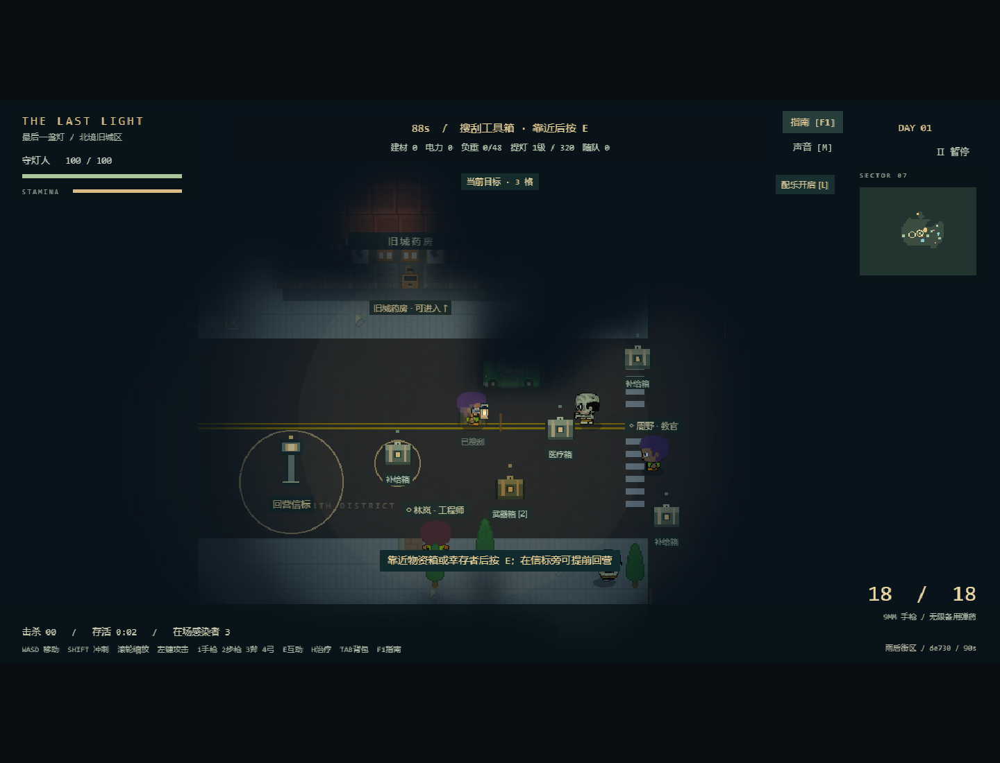

# 最后一盏灯 · The Last Light

使用 Phaser + TypeScript 实现的 2D 末日生存探索与即时防御游戏。

**v0.11：成团多向围城、攻城破墙、连续场景演出。** 第一批验收和源码诊断见 [围城与演出记录](docs/18-v0.11-siege.md)。Space跳过演出，V减少动态；`?difficulty=hard` 可选困难。保留v0.10成长、48负重和已有存档，以下设施与操作仍适用。

**当前版本 v0.10.1：密集空地尸潮、拖动铺墙与快捷出售。** 保留序章、提灯探索、90秒白天 / 30秒布防 / 120秒夜战，首次通关逐步开放施工空间、设施与人物。首夜第二波即有腐鸦空袭，后期队伍更密集；首阶段Boss只迎战巨汉；第二阶段开放电网、维修站、电工与战地医师，迎击女皇和喷毒者；最终阶段开放火焰塔、狙击塔和重火力英雄，抵御空地尸潮、自爆巨怪与最终双 Boss。没有增加后端或更换引擎。

| 阶段 | 可施工范围 | Boss编成 | 首次胜利补给 |
| --- | --- | --- | --- |
| 1 余烬初守 | 40×24格 | 末波裂颅巨汉 | 12建材 / 4电力 |
| 2 雾潮围城 | 46×29格 | 第3波女皇、第5波喷毒者 | 16建材 / 6电力 |
| 3 长夜决战 | 54×34格 | 骑士 → 巨鸟 → 自爆巨怪 → 女皇+喷毒者 | 20建材 / 8电力 |

结算 **Enter重试原阶段**；点击“返回城市”探索后重新布防，进入新解锁阶段。奖励每阶段只发一次，第三阶段后不再无限提高难度。旧v2存档保留库存、人物、灯级与阵地，缺少成长字段时从第一阶段开始。本轮调整见[v0.10.1验收](docs/17-assault-and-building.md)。完整成长设计、取舍、测试和演示路线见 [v0.10成长与验收](docs/16-progression.md)。

一轮仍为探索 **90 秒** + 布防 **30 秒** + 夜战 **120 秒**，默认约 4 分钟；前两段可提前结束。夜战三倍速约 40 秒，快速课堂路线可压到约 1–2 分钟（另留阅读/操作时间）。首次序章额外约 9 秒，可 Enter / Space / Esc 跳过，不消耗探索预算。



## 启动与操作

需要 Node.js 24+。

```bash
npm ci
npm run dev
```

打开终端中的本地地址，首次会播放序章，之后进入城市探索。同一标签页记住已观看；可用 `/?intro=1` 重播。点击画面获得焦点。推荐桌面键鼠。建议短路线：工具箱 → 步枪箱 → 右上急救补给箱 → 工程师 → 暖黄色信标按 E；可获得 16 建材 / 2 电力（含工程师返营奖励）。搭配机枪塔、两座箭塔和沙袋形成交叉火力。无需等待倒计时结束，详细摆位见 [v0.8 验收](docs/13-bosses-and-variation.md)。

| 操作 | 按键 |
| --- | --- |
| 移动 | WASD / 方向键 |
| 瞄准与射击 | 鼠标瞄准，按住左键射击 |
| 换弹 | R；空弹匣后自动换弹 |
| 冲刺 | 按住 Shift，消耗体力 |
| 暂停 / 继续 | Esc / P，或右上角按钮 |
| 当前阶段操作指南 | F1 / 顶栏“指南”，查看时暂停；关闭后保留原先的暂停状态 |
| 白天 / 夜战声音 | M / 声音按钮，静音偏好跨场景保留 |
| 背景配乐单独开关 | L / 配乐按钮；首次操作解锁，暂停/失焦停播，倍速不变调 |
| 探索镜头缩放 | 鼠标滚轮，0.65～1.5 倍，HUD 保持固定 |
| 搜刮 / 营救 / 信标回营 | 靠近目标按 E |
| 武器切换 | 1 手枪 / 2 步枪（武器箱）/ 3 消防斧 / 4 猎弓（药房室内储藏箱） |
| 背包 | Tab / B，打开时暂停计时；Esc 关闭 |
| 治疗 | H，受伤且有急救包时恢复最多 50 生命 |
| 战败重试 / 成功回营后进入基地 | Enter / 按钮 |

工程师返营额外回收建材，医护员救援时治疗，教官随队加快换弹。背包负重上限 48，搜刮整箱放不下时保留原箱。无限备用弹药用于当前演示，枪械仍有弹匣、射速和换弹限制。

所有建筑从标有“可进入 ↑”的南门步行进入，靠近门口/进入时屋顶隐藏，墙体和家具真实阻挡移动与弹体。首次进屋通常出现两名感染者（受在场 16 只上限限制），不因反复进门刷新；每栋建筑有一箱可搜刮补给。药房有弓手叶青和猎弓，便利店有持斧先锋石川；救援后自动协助战斗，返营分别增加一名对应兵种守卫。默认三名枪手，教官再增加一名；弓手、先锋与两位英雄合计最多八人。

消防斧朝鼠标方向扇形横扫，48 伤害、70 像素距离、0.6 秒间隔，不耗弹药，不能隔墙命中；猎弓为慢射速、高单发伤害的真实箭体，切换后需等待攻击冷却。白天随队人物暂不受伤，先锋需要靠近敌人才能发挥作用。

到 90 秒自动黄昏收队；提前回营需到信标附近按 E，等队员跟上。只有结束时距主角 150 像素内的已汇合队员计入营救。失败不会带回本轮物资。回营后写入独立 `last-light.campaign.v2` 营地存档，刷新可查看累计库存；探索中途刷新会丢失本轮进度，旧 `last-light.save.v1` 不读写。每次出发固定从手枪开始，步枪营地解锁记录暂不用于出发配装。

## 提灯、迷雾与家园

黑雾吞没旧城，北境灯塔为幸存者留下家园。玩家是守灯人：白天带灯寻找补给、武器与幸存者，黄昏建设防线，夜晚守住灯塔直到天亮。序章使用现有像素场景、怪物剪影、旋转灯束和幸存者动画，不要求阅读长对话。

探索初始照明半径 240 像素，墙体遮挡光线。未探索区被黑雾遮住，离开后仅保留暗色地形；敌人与人物只在当前视线中显示，小地图不再提前泄露全部补给和人物。任务方向与回营信标仍作为已知情报显示。

街边 (1152,688) 的金色箱提供聚光镜片，将半径升到 320；药房室内 (1024,432) 的箱子同时提供猎弓和高能灯芯，将半径升到 400。镜片不占负重，不能重复强化或把高级灯降级。灯光升级即时生效，但只有安全返营/成功黄昏收队才入库；失败丢失本轮新升级，已带回的灯级下次出发自动使用。

出发、归来、进入基地、入夜、Boss、黎明和失守使用1.25–2.7秒真实场景镜头、雾流、灯束与音色演出；演出不消耗额外阶段预算，不随倍速加快。Space跳过，V减少动态，镜头操作随时接管；暂停/指南/失焦冻结表现与模拟。

## 基地布防操作

回营摘要中按 Enter，消耗真实营地库存布防；也可通过 `/?mode=base` 查看已有基地。新营地只有 3 名守卫，没有免费建设物资，需要先探索带回补给。营救教官后增加 1 名守卫，工程师使每座设施少耗 1 建材。新阶段可在远处维修站救出战地医师、供电管理救出电工，最终阶段旧公寓出现重炮手；英雄救援会触发额外感染者，仍需护送返营。

| 操作 | 按键 |
| --- | --- |
| 建造路障 / 机枪塔 / 加农炮 / 箭塔 / 城墙 | 1 / 2 / 3 / 4 / 5，随后左键点击虚线区域；城墙按住左键拖动可连续铺设 |
| 建造电网 / 维修站 / 火焰塔 / 狙击塔 | 6 / 7 / 8 / 9；按阶段解锁 |
| 旋转沙袋 / 取消建造 | R / Esc 或右键 |
| 选兵 / 多选 | 左键、拖框；Shift 加选；Space 全选 |
| 编队移动 / 就地驻守 | 右键地图 / G |
| 镜头移动 / 缩放 | WASD 或方向键 / 鼠标滚轮 |
| 镜头回灯塔 / 定位 | C / 点击右上角战术地图；小地图点击不下令、不建造、不消耗支援 |
| 出售设施 | 左键选中设施后点“出售”，或 X / Delete；返实际支付建材的50%，向下取整但最低1，电力不返 |
| 完成布防并开始守夜 | Enter；30 秒后也会自动入夜 |
| 布防 / 夜战倍速 | T / 顶栏倍速按钮，1 → 2 → 3 → 1；暂停和终局不能切换，新阶段默认 1 倍 |

| 设施 | 原价（建材 / 电力） | 耐久 | 用途 |
| --- | --- | --- | --- |
| 沙袋路障 | 3 / 0 | 160 | 64×32 掩体，可旋转 |
| 机枪塔 | 6 / 2 | 100 | 260 射程，快速单体弹道 |
| 加农炮 | 7 / 3 | 105 | 310 射程，慢速炮弹，62 像素范围伤害 |
| 箭塔 | 5 / 0 | 90 | 340 射程，单体箭矢，无电力成本 |
| 木栅城墙 | 1 / 0 | 80 | 32×32，低价可多建，敌人能攻破 |
| 电网装置（阶段2） | 6 / 3 | 110 | 150范围，每0.6秒地面4伤害，45%减速0.9秒 |
| 维修站（阶段2） | 7 / 3 | 125 | 每3秒修复180范围内其他设施8点；不修灯塔/自己 |
| 火焰塔（阶段3） | 8 / 3 | 140 | 145范围，每0.3秒地面群体12伤害 |
| 狙击塔（阶段3） | 10 / 4 | 85 | 520射程，115伤害/2.4秒，对空/地，优先Boss |

建筑数量不设硬上限，仍受地图可用网格和实际库存约束。工程师使每座少耗 1 建材，最低仍为 1，不会免费造墙。不能重叠、封堵十字通道、压住士兵/目的地或把士兵围困。夜战士兵与防御塔自动攻击，敌人能击毁设施并杀伤部队；先锋不能隔墙挥斧，灯塔耐久归零即失守。

库存、阵地和指令用同一个存档原子写入。建设、拆除、下令、完成、返回探索时保存，不逐帧保存行军位置。旧 v2 存档自动补空基地，旧 v1 不读写。写失败时提示未保存，仍能继续操作。

## 夜战

六类普通敌人与六种Boss按阶段编成，前锋、集群、侧袭、突破、全面围城分段出动。普通模式实际计划120/222/345名（不含召唤），同批在同一接敌线集中，后期四向同时推进；末轮提前到84/84/82秒，让重装有时间接近。真实实体最多96、弹体160、粒子200；未出兵力排队，外围轮廓来自实际敌人。没有增加敌种基础生命或伤害。持续至120秒且灯塔存活即胜利，同一步归零优先判负。

| Boss | 特性与应对 |
| --- | --- |
| 裂颅巨汉 | 重斧范围攻击，0.95 秒预警，调兵离开圈内 |
| 蜘蛛女皇 | 蛛网持续伤害并减速，召唤快速蜘蛛幼体 |
| 亡灵骑士 | 25% 护甲减伤，召唤有轻甲的亡灵侍从，集中火力 |
| 腐羽巨鸟 | 飞越墙体，腐羽风暴持续伤害；机枪、箭塔、狙击和枪/弓守卫能对空 |
| 蚀雾喷吐者 | 360射程锁定毒池，1.1秒预警，持续5秒；调兵离开落点 |
| 熔囊巨怪 | 靠近后1.6秒蓄力、125范围自爆；可用集中火力击杀打断，自爆不计玩家击杀 |

近战先锋与加农炮仅攻击地面目标，城墙不能拦住飞行单位。顶部显示 Boss 血条和技能说明，地面出现落点预警；小地图金色为 Boss、紫色为普通飞行敌人。基地世界 2048×1408，可建设范围从1280×768扩至1728×1088（约1.91倍），灯塔和原阵地坐标保持兼容，缩放最低0.5倍；战术地图显示本阶段施工边界。

| 操作 | 效果 |
| --- | --- |
| 选兵、右键、G、Space、镜头操作 | 延续布防操作，可在夜战实时调动部队形成交叉火力 |
| F，再左键落点 | 有限炮火支援，0.65 秒后范围爆炸，不伤己方；右键/Esc 取消 |
| M / 声音按钮 | 白天和夜战音效开关，首次键鼠操作后解锁；静音偏好保留 |
| P / Esc / 暂停按钮 | 暂停尸潮、部队、计时和音效；失焦自动暂停 |
| 终局 Enter | 使用入夜前阵地再次挑战；或点击返回城市开始新一轮 |

每夜自带 1 次营地支援，白天取得步枪后为 2 次，冷却 8 秒，只能打己方视野内落点。医护员名单每 8 秒给一名受伤生还守卫恢复 8 生命。备用弹药仍无限；夜间禁止施工/拆除。具备动态视野迷雾、暖色灯束、弹道/命中/爆炸、限量尸体、黎明与胜负画面、原创合成音效。白天为柔和钟琴/和弦循环，夜战增加低音节奏；L 单独控制配乐，M 控制全部声音。

倍速通过更多固定步长推进整个模拟：移动、子弹、攻击冷却、波次、支援、治疗与截止时间同步加速。镜头移动、UI 和配乐保持正常时间，避免操作突然过快或音乐升调。

战术地图显示己方守卫、设施和当前视野内敌人，白框表示镜头范围。顶栏预告下一波时间与类型，尸潮开始时提示。F1 指南提供本阶段操作和演示建议，覆盖时不会触发下面的战斗/施工按钮；从背包或暂停状态进入指南，关闭后仍保持原状态。失焦后需主动恢复。

入夜前阵地作为本轮重试检查点；战后保存摘要、成功次数、通关阶段和一次性补给，不把战损写回阵地；这是可控范围的三阶段成长。夜战中途刷新从入夜前检查点重新开始，不宣称支持断点续战。资源不因重试恢复到建造前，首次胜利补给按阶段记录，重试同阶段不可重复领取。

练习入口：`/?mode=combat` 为原战斗训练；`/?mode=base` 为布防训练，完成后 Enter 继续调整、N 开始夜战；`/?mode=night` 直接使用已有阵地守夜，没有免费设施。默认入口为完整流程。

## 验证

```bash
npm test
npm run build
npm run test:e2e
npm run test:legacy
npm run simulate:night
npm run simulate:progression
```

浏览器测试默认使用本机 Chrome。无 Chrome 时执行 `npx playwright install chromium`，设置 `PLAYWRIGHT_CHROMIUM=1`。生产产物验证先构建，再设置 `E2E_PRODUCTION=1` 运行浏览器测试，详见测试文档。

## 文档

- [v0.10三阶段成长与验收](docs/16-progression.md)
- [需求分析](docs/01-requirements.md)
- [游戏设计](docs/02-game-design.md)
- [技术架构与旧版处置](docs/03-architecture.md)
- [路线与 Git 提交](docs/04-roadmap.md)
- [测试、追溯与人工验收](docs/05-testing.md)
- [真实协作与决策](docs/06-decisions.md)
- [素材来源与许可](docs/07-assets.md)
- [现场演示与阶段 2 验收](docs/08-stage2-demo.md)
- [探索至基地的现场演示与阶段 3 验收](docs/09-stage3-demo.md)
- [完整昼夜演示与阶段 4 验收](docs/10-stage4-demo.md)
- [v0.6 体验优化与验收](docs/11-polish.md)
- [v0.7 室内、武器、防御与倍速验收](docs/12-expansion.md)
- [v0.8 Boss、尸潮、扩大基地与变化街区验收](docs/13-bosses-and-variation.md)
- [v0.9 序章、提灯迷雾、扩容与转场验收](docs/14-story-and-fog.md)

## 目录

```text
src/config/       地图、角色、枪械、素材配置
src/core/         独立于 Phaser 的战斗、碰撞、寻路与状态
src/scenes/       Phaser 载入、输入、镜头和循环
src/view/         地图对象、角色动画、特效与 HUD
public/assets/    本地游戏素材和许可
tests/            当前规则与浏览器测试
legacy/v0.1/      旧版源代码和测试，不进入新入口
docs/legacy-v0.1/ 旧版历史文档
```

阶段 2 基线提交 `baa1804`，阶段 3 提交 `b673609`；阶段 4 分支 `codex/night-defense-stage-4`。每个实际阶段独立保存，不回填历史。当前完成本地可玩闭环与构建，尚未运行线上部署。

Phaser 3.90.0、TypeScript、Vite。美术来自 Kenney 与 Curt 的 CC0 像素素材，来源与使用范围见素材文档。运行时不依赖 CDN。
