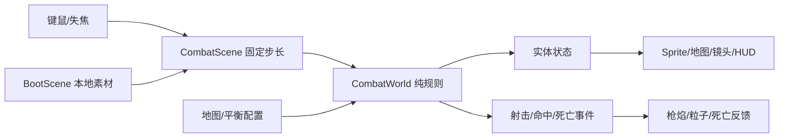
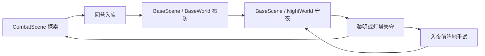

# 技术架构与重构范围

## 仓库审计

初次检查时为无首笔提交的 main，项目全部未跟踪；远端为 `https://github.com/LiGuanheng/SEAPP.git`。阶段 2 已按用户授权以 `baa1804` 作真实首笔提交并推送，未回填此前历史。阶段 3 从该基线建立 `codex/base-command-stage-3`。旧实现仍完整归档。

| 旧实现 | 处置 |
| --- | --- |
| TypeScript/Vite、CI/手动部署 | 复用，加入 Phaser 并更新测试 |
| 固定步长、确定性规则、边界测试 | 复用思想，实时战斗单独实现 |
| 旧探索、塔防、存档、配置 | 完整移至 legacy/v0.1/src/game，后续评估复用，本轮不运行 |
| DOM 面板、旧 Canvas renderer、旧入口 | 完整归档，退出当前游戏 |
| 旧规则与存档测试 | 归档，可独立 test:legacy；旧浏览器案例不在新 CI 运行 |
| 旧文档 | docs/legacy-v0.1，仅作历史 |
| 旧 localStorage 存档 | 新入口不读写；探索使用独立 v2 营地存档 |

## 架构

Phaser 3.90.0 + TypeScript + Vite。Phaser 管理场景、纹理、动画、输入和镜头；纯 TS 模型管理位置、碰撞、子弹、伤害、寻路和失败。使用轻量运动学碰撞，避免两个物理系统同时修改位置。

| 模块 | 接口或职责 |
| --- | --- |
| config/map.ts、balance.ts | 街区、障碍、出生点、速度、枪械、敌人与上限配置 |
| core/geometry.ts | 圆/AABB、分轴滑动、线段与圆/矩形求交，防高速子弹穿透 |
| core/navigation.ts | 膨胀障碍导航格、共享 BFS 距离场；禁止对角穿墙角 |
| core/world.ts | CombatWorld.step(input,dt)、requestReload；位置/状态/事件；失败冻结 |
| scenes/BootScene.ts | 本地素材载入、动画帧注册、载入错误处理 |
| scenes/CombatScene.ts | 输入、固定 1/60 秒循环、暂停/重试、镜头换算 |
| view/MapView.ts | Tilemap 地面、建筑与环境对象 |
| view/ActorView.ts | 模型同步到角色、枪械、阴影、动画和特效 |
| view/Hud.ts | 场景内信息与暂停/失败操作 |
| config/weapons.ts | 手枪/步枪参数，独立弹匣与逐弹伤害 |
| core/expedition.ts | ExpeditionWorld 继承战斗；搜刮、背包、职业、跟随、倒计时、单次结算 |
| core/campaign.ts | Cargo / Campaign v2 / ExpeditionSummary；严格解码、克隆、读写失败回退 |
| view/ExpeditionView.ts | 补给箱、信标、职业 NPC 的实际世界对象和动画、目标光圈与交互提示 |

Player：位置、生命、体力、瞄准、弹匣、换弹/射击/无敌计时。Zombie：ID、位置、生命、攻击冷却、受击状态、朝向。Bullet：前后位置、速度、寿命。事件为每步一次的射击、撞墙、受击、击杀与换弹通知。

## 关键约束

- 固定步长与累积上限，后台暂停不补进度；暂停清输入。
- 归一移动与分轴碰撞，实体按半径绕障；视线可通时直接追击，阻挡时使用距离场。
- 子弹比较最近墙体与最近敌人的连续交点，先撞墙不允许杀墙后敌人。
- 攻击冷却、短暂无敌、死亡只触发一次，重试建新模型。
- 弹体、敌人、事件、尸体和特效有数量或寿命限制。
- 旧模型与存档归档，不把不兼容数据直接载入实时战斗。
- E2E 的 `?test=1` 仅开放只读诊断快照，不提供瞬移、刷怪或改血接口。正常入口不暴露诊断。

## 阶段 2 数据与接口

`CombatWorld` 保留独立训练规则，增加 `weaponId / ownedWeapons / switchWeapon / acquireWeapon`；子弹创建时记录 damage，避免换枪改变在途子弹。探索继承并覆写生成频率、敌人上限和职业换弹修正。基类不依赖 Phaser 或存档。

`ExpeditionWorld.interact()` 返回 `{ok,message}`，根据距离与无遮挡检查选最近未开箱/未营救 NPC，或在信标返营。一次交互原子修改状态；失败不扣物资或开箱。`useMedkit()` 同样先校验。`step()` 先执行战斗，再更新随从；存活到 90 秒进入 complete，defeat/complete 均拒绝后续操作。结算私有且检查 playing，保证只入库一次。

Campaign v2 = version、expeditions、depot、survivors、weapons、lastSummary，以及兼容增加的 base。摘要记录原因、耗时、击杀、箱数、带回队员、背包和工程师奖励。构造时克隆数据，探索失败不改营地；BaseWorld 直接消费库存并读取职业名单。

场景只在 complete 时尝试保存一次到 `last-light.campaign.v2`。读取/解析/结构错误使用新营地并提示，读取失败不会立即覆盖原数据；下一次成功结算才尝试写入。存储被禁用或容量不足时保留结算画面并明确未保存。旧 `last-light.save.v1` 完全不读写。未实现中途存档。

输入新增 E/H/1/2/Tab/B。背包共用暂停机制清除移动/开火，关闭后不自动复用按住输入。默认探索，`?mode=combat` 训练；`?test=1` 仅只读快照附加 expedition 信息，浏览器自动化仍通过真实键鼠操作，不用瞬移或改血接口。

## 阶段 3 模块与数据

| 模块 | 职责 |
| --- | --- |
| config/base.ts | 地图、占地/通道、设施参数、BasePlan/Soldier 与严格校验 |
| core/base-world.ts | 原子建造/拆除、队形分配、逐士兵导航、身体碰撞/分离、驻守、30 秒布防 |
| scenes/BaseScene.ts | 点击/框选/指令、镜头坐标换算、固定步长、暂停、存档与场景衔接 |
| view/BaseView.ts | Tilemap、灯塔/设施、军盔/枪械/动画、选择圈/路径、建造预览 |
| view/BaseHud.ts | 固定 HUD、资源成本、提示与布防摘要 |

探索摘要 Enter 将 Campaign 交给 BaseScene；`?mode=base` 可读已有阵地。BaseWorld 克隆数据，BasePlan v1 持有 preparing/ready、elapsed、设施数组与士兵数组。设施含 id/kind/网格坐标/rotation/health/paid；士兵含 id/脚底位置/aim/destination/stance/moving。

建设先验证网格、边界、资源、占地、通道、部队/目的地，再用候选设施导航场确认士兵仍可通往灯塔通道，最后一次扣费。拆除按 paid 回收；设施变化重建在途导航。右键先为全组选出独立可达落点，再整体下令，失败保留原指令。每个士兵最多一个导航场，重复指令不累积缓存。

世界对象归入 BaseView.root，HUD 归入 BaseHud.root。主相机只渲染世界并平移/缩放，独立 UI 相机只渲染 HUD，避免缩放使按钮漂移。指针显式转换到主相机世界坐标。

旧 v2 缺 base 时补 null，不另设资源存档键。库存与阵地同一 JSON、一次 setItem，避免扣费和设施部分落盘。建设、拆除、下令、完成、回城市时保存；不逐帧写行军位置，刷新从最近保存的位置/指令继续。读取失败不在入场时覆盖原数据；写失败保留当前阵地并明确提示。仅 `?test=1` 开放只读 `__baseLight.snapshot()`，退出场景删除，普通入口无接口。

## 阶段 4 夜战架构

阶段 3 已提交 `b673609`；本轮基于该提交建立 `codex/night-defense-stage-4`。不运行旧版固定路径塔防引擎，复用当前实时碰撞、导航、阵地与键鼠指挥。

| 模块 | 职责 |
| --- | --- |
| config/night.ts | 120 秒、五波三类敌人、入口、实体上限 |
| core/night-world.ts | 继承 BaseWorld 指挥与单位运动；尸潮、自动射击、连续弹道、伤害、摧毁、支援、胜负与幂等结果 |
| view/NightView.ts | 敌人动画、健康条、尸体/粒子、枪焰/弹体、灯束与低分辨率软遮罩 |
| view/NightHud.ts | 灯塔耐久、波次/倒计时、选择与支援、音效开关、暂停和胜负 |
| view/SoundBus.ts | 用户操作解锁 Web Audio，原创噪声音色与低频环境，限 8 声部、节流枪声、静音/暂停/销毁 |

BaseWorld 抽出 commanding、livingSoldiers、stepSoldiers、rebuildNavigation；BaseScene 使用同一选择/镜头输入驱动布防或守夜，默认布防结束重启同场景并带 battle 标志。`?mode=base` 明确保留训练摘要，N 才守夜；不借助测试参数改变战斗速度或血量。

NightWorld 持有独立战斗状态：敌人数组、子弹、fighters 健康/冷却、炮塔瞄准/冷却、灯塔耐久、队列与支援。入夜时深拷贝合法布防检查点；战斗损失只改本局，终局 resultCampaign() 缓存同一结果，在检查点副本中增加 lastNight 与 nightsWon，重复调用不重复加胜场。夜战下令不把损坏阵地存成基地计划。

敌人共享通往灯塔附近的导航场，邻近守卫/设施时改为局部接敌。设施摧毁后重建双方导航。己方子弹对最近敌人和静态建筑连续求交，矮掩体不挡己方火力。支援独立倒计时和范围伤害。固定步长钳到 120 秒剩余时间，末步先判灯塔是否归零，再判黎明。

夜视遮罩为 768×512 CanvasTexture，每 0.1 秒或终局变化刷新，放大到世界，避免每帧上传全分辨率；可见性按灯塔/守卫/炮塔半径决定。尸体、粒子、敌人与子弹都受上限或寿命约束。世界与 HUD 仍由独立相机渲染。

v2 兼容新增可选 nightsWon/lastNight，严格校验时长、结果与耐久一致性；无字段的旧档可继续读取。终局只保存一次，失败保留重试阵地，存储拒绝不阻断游戏。夜战中途不存战场，刷新重新开始检查点。仅 `?test=1` 暴露只读 __nightLight，场景退出清除，不提供改血/跳时/刷怪接口。
