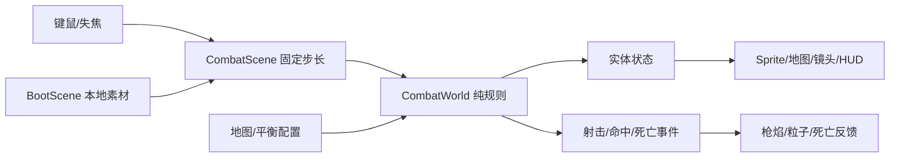

# 技术架构与重构范围

## 仓库审计

初次检查时为无首笔提交的 main，项目全部未跟踪；远端为 `https://github.com/LiGuanheng/SEAPP.git`。阶段 1 使用 `refactor/phaser-stage-1`，本轮使用 `codex/expedition-stage-2`，仍无首笔提交，未代用户 commit/push。因无基线，暂时不能比较跨分支历史，旧实现以完整目录归档保护。

| 旧实现 | 处置 |
| --- | --- |
| TypeScript/Vite、CI/手动部署 | 复用，加入 Phaser 并更新测试 |
| 固定步长、确定性规则、边界测试 | 复用思想，实时战斗单独实现 |
| 旧探索、塔防、存档、配置 | 完整移至 legacy/v0.1/src/game，后续评估复用，本轮不运行 |
| DOM 面板、旧 Canvas renderer、旧入口 | 完整归档，退出当前游戏 |
| 旧规则与存档测试 | 归档，可独立 test:legacy；旧浏览器案例不在新 CI 运行 |
| 旧文档 | docs/legacy-v0.1，仅作历史 |
| 旧 localStorage 存档 | 新入口不读写；探索使用独立 v2 营地存档 |

## 架构

Phaser 3.90.0 + TypeScript + Vite。Phaser 管理场景、纹理、动画、输入和镜头；纯 TS 模型管理位置、碰撞、子弹、伤害、寻路和失败。使用轻量运动学碰撞，避免两个物理系统同时修改位置。

| 模块 | 接口或职责 |
| --- | --- |
| config/map.ts、balance.ts | 街区、障碍、出生点、速度、枪械、敌人与上限配置 |
| core/geometry.ts | 圆/AABB、分轴滑动、线段与圆/矩形求交，防高速子弹穿透 |
| core/navigation.ts | 膨胀障碍导航格、共享 BFS 距离场；禁止对角穿墙角 |
| core/world.ts | CombatWorld.step(input,dt)、requestReload；位置/状态/事件；失败冻结 |
| scenes/BootScene.ts | 本地素材载入、动画帧注册、载入错误处理 |
| scenes/CombatScene.ts | 输入、固定 1/60 秒循环、暂停/重试、镜头换算 |
| view/MapView.ts | Tilemap 地面、建筑与环境对象 |
| view/ActorView.ts | 模型同步到角色、枪械、阴影、动画和特效 |
| view/Hud.ts | 场景内信息与暂停/失败操作 |
| config/weapons.ts | 手枪/步枪参数，独立弹匣与逐弹伤害 |
| core/expedition.ts | ExpeditionWorld 继承战斗；搜刮、背包、职业、跟随、倒计时、单次结算 |
| core/campaign.ts | Cargo / Campaign v2 / ExpeditionSummary；严格解码、克隆、读写失败回退 |
| view/ExpeditionView.ts | 补给箱、信标、职业 NPC 的实际世界对象和动画、目标光圈与交互提示 |

Player：位置、生命、体力、瞄准、弹匣、换弹/射击/无敌计时。Zombie：ID、位置、生命、攻击冷却、受击状态、朝向。Bullet：前后位置、速度、寿命。事件为每步一次的射击、撞墙、受击、击杀与换弹通知。

## 关键约束

- 固定步长与累积上限，后台暂停不补进度；暂停清输入。
- 归一移动与分轴碰撞，实体按半径绕障；视线可通时直接追击，阻挡时使用距离场。
- 子弹比较最近墙体与最近敌人的连续交点，先撞墙不允许杀墙后敌人。
- 攻击冷却、短暂无敌、死亡只触发一次，重试建新模型。
- 弹体、敌人、事件、尸体和特效有数量或寿命限制。
- 旧模型与存档归档，不把不兼容数据直接载入实时战斗。
- E2E 的 `?test=1` 仅开放只读诊断快照，不提供瞬移、刷怪或改血接口。正常入口不暴露诊断。

## 阶段 2 数据与接口

`CombatWorld` 保留独立训练规则，增加 `weaponId / ownedWeapons / switchWeapon / acquireWeapon`；子弹创建时记录 damage，避免换枪改变在途子弹。探索继承并覆写生成频率、敌人上限和职业换弹修正。基类不依赖 Phaser 或存档。

`ExpeditionWorld.interact()` 返回 `{ok,message}`，根据距离与无遮挡检查选最近未开箱/未营救 NPC，或在信标返营。一次交互原子修改状态；失败不扣物资或开箱。`useMedkit()` 同样先校验。`step()` 先执行战斗，再更新随从；存活到 90 秒进入 complete，defeat/complete 均拒绝后续操作。结算私有且检查 playing，保证只入库一次。

Campaign v2 = version、expeditions、depot（三种非负整数资源）、survivors（去重职业 ID）、weapons（去重已知武器 ID）、lastSummary。摘要记录原因、耗时、击杀、箱数、实际带回队员、背包和工程师额外回收。构造时克隆营地数据，失败不修改外部存档。营地库存与人物未来提供给建设阶段；本轮没有 RTS 空实现。

场景只在 complete 时尝试保存一次到 `last-light.campaign.v2`。读取/解析/结构错误使用新营地并提示，读取失败不会立即覆盖原数据；下一次成功结算才尝试写入。存储被禁用或容量不足时保留结算画面并明确未保存。旧 `last-light.save.v1` 完全不读写。未实现中途存档。

输入新增 E/H/1/2/Tab/B。背包共用暂停机制清除移动/开火，关闭后不自动复用按住输入。默认探索，`?mode=combat` 训练；`?test=1` 仅只读快照附加 expedition 信息，浏览器自动化仍通过真实键鼠操作，不用瞬移或改血接口。
