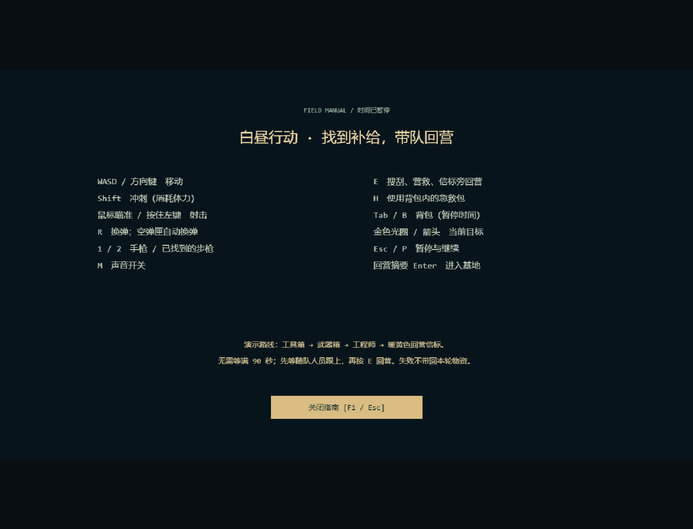
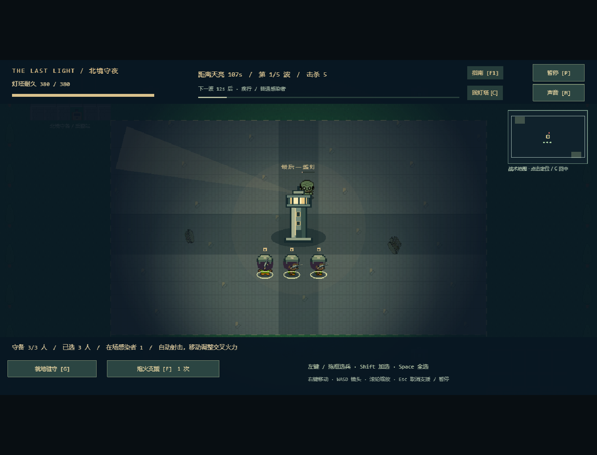

# v0.6 体验优化与现场验收

本轮基于完整昼夜版本 cceb69a，只优化首次试玩与操作稳定性，不引入多日养成。时间仍为探索 90 秒、布防 30 秒、守夜 120 秒；前两段可以提前结束。

## 改动与需求追溯

| 需求 | 实现 | 浏览器证据 |
| --- | --- | --- |
| R-33 | FieldGuide、两场景暂停状态与遮罩 | 指南冻结世界，Enter/E/施工/支援无效；关闭后保留背包、原暂停与失焦暂停 |
| R-34 | Hud 方向/距离/目标圈，SoundBus.combat/pickup | 移动至离屏目标后截图；真实开枪和搜刮启动音源；静音跨真实返营/布防/夜战保留 |
| R-35 | TacticalRadar、BaseScene.home、NightHud 预告 | 两模式小地图定位/C 回中；不下令、不消耗支援；来袭与夜战截图 |
| R-36 | CombatScene.advance 显式传 Campaign | 合法营地载入后禁用读写，真实等待感染者击杀、重试，库存与名单仍保留 |
| R-22、R-17 | CombatUI 独立相机、交互遮罩 | 探索镜头移动后正确点击指南；背包挡住被遮盖的暂停按钮 |

## 人工体验顺序

1. `npm ci` 后 `npm run dev`，打开本地地址，直接开始探索。
2. 按 F1 看指南，再关闭；尝试移动、射击、R 换弹及 M 开关声音。检查枪声/音量是否舒适。
3. 离开初始区域，观察金色目标箭头、格数距离与小地图目标圈。它是方向指示，不是自动寻路路线，需要自行绕障碍。
4. 搜刮工具箱、拿步枪、救工程师，带队回信标按 E；摘要 Enter 布防。
5. 建塔、建路障，选兵下令；移动/缩放镜头后按 C，或点击小地图定位。按 F1 时计时应停止，关闭再继续。
6. Enter 入夜；观察下一波预告、来袭提示与可见敌人小地图。F 进入支援后点小地图只能定位，点真正战场才发射。
7. 打开背包/暂停后再 F1，关闭指南仍应暂停；切出窗口再回来也需主动恢复。终局可 Enter 重试。

## 证据与边界

本轮完整验证：规则/素材 40/40、归档规则 22/22、生产浏览器 20/20（约 2.2 分钟）、严格类型检查与构建通过。完整案例涵盖真实探索至守夜胜利，失败/重试与 90 秒自动收队另有覆盖。新增五项操作/异常存储回归均通过。

最终训练指南/终局按钮与重复音频暂停调用整理后重建，受影响 combat/polish 浏览器案例另跑 11/11 通过（46.2 秒）。

自动化覆盖真实键鼠与生产构建，世界接口仅只读。虚拟时钟验证模拟流程，不作为真实时间帧率测量。音频测试监测实际 Web Audio 音源启动及静音路径，实际听感仍待用户判断。

实机截图保存在 artifacts/polish-*.png；代表性图片原样复制到 docs/screenshots 供仓库查看。没有修改截图来伪造效果。

保留原限制：桌面键鼠、Chrome 验证，软半径视野，无中途续战和多日养成。低配置机器帧率、其他浏览器及主观美术/操作尚待人工体验；构建仍有 Phaser 引擎大包提示。未执行线上部署。
