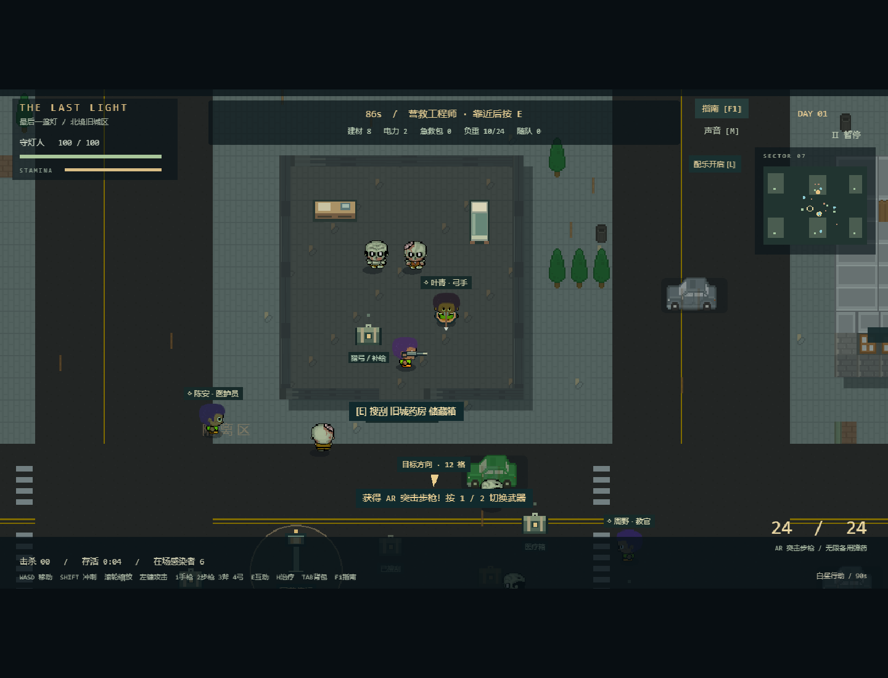
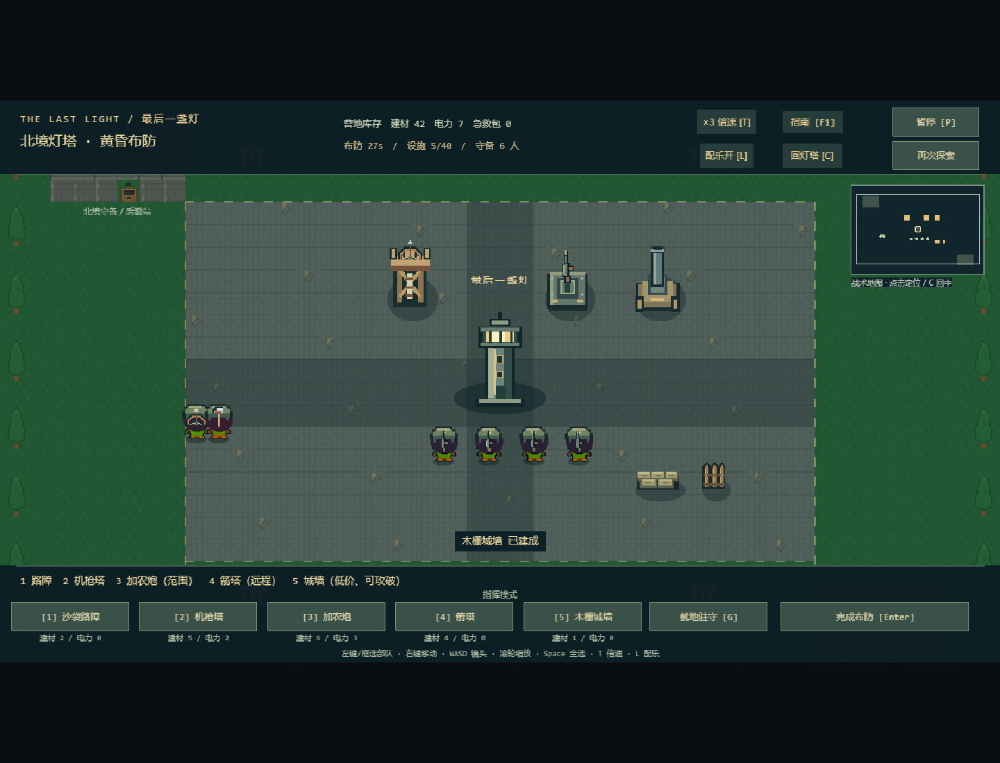

# v0.7 室内、武器、防御与倍速

基于 cf2ea86 建立 codex/rooms-and-arsenal。用户明确提出配乐、缩放、2/3 倍速、可进入房间、不同武器角色、防御塔与可破城墙。本轮将这些能力接入既有单昼夜，不扩展多日养成。

## 可玩内容与人工验收

1. 默认地址直接进入探索；按任意操作键解锁音频。L 单独开关配乐，M 全部声音。白天钟琴/和弦，夜战增加低音节奏；暂停和切出窗口应停播。请人工判断旋律与音量是否舒适。
2. 在场景中央滚轮缩放，移动/瞄准射击，HUD 不随世界缩放。按 3 朝鼠标挥斧：近距离横扫，无弹药消耗，隔墙不能命中。1 回手枪，2 需先拾取室外军用武器箱。
3. 旧城药房南门在世界坐标约 (1072,512)，从下方走入，屋顶自动隐藏。室内有两只感染者、桌子/床、储藏箱及弓手叶青；清敌后靠近箱子 E，获得猎弓与物资，4 装备猎弓。切换武器需要等待本武器攻击冷却，弓的射速较慢。
4. 营救弓手后从同一门口出屋，等其跟上，再回信标 E。便利店南门约 (1072,1280)，室内可选营救持斧先锋石川。六处建筑都可进入并搜刮，反复进出不会重复刷守卫或补给。90 秒探索时间不变，不必搜完全部房间。
5. 返营 Enter 布防：1 路障、2 机枪塔、3 加农炮、4 箭塔、5 木栅城墙。城墙 1 建材/80 耐久，可多建，总设施上限 40；工程师不能使其免费。使用真实营地库存，无免费示范资源。
6. 加农炮用慢速炮弹打范围伤害，箭塔射程远、单体攻击；选中可看射程。营救名单决定最多六名守备，包括枪手、弓手和先锋；先锋适合前排，弓手在后排。
7. T 或顶栏按钮切换 1/2/3 倍速。倒计时、移动、攻击、支援与波次同步加速；镜头和音乐保持正常。暂停应冻结全部模拟且不能切倍速；进入新阶段默认回到 1 倍。
8. 正常 Enter/倒计时入夜。可观察炮塔转向、箭矢/炮弹/斧光、城墙受击与破坏。三倍速守满一夜约 40 秒；终局仍严格在模拟时间 120 秒判定并冻结。

## 数据与规则

| 内容 | 参数/规则 |
| --- | --- |
| 消防斧 | 48 伤害，70 像素扇形，0.6 秒间隔，不能隔墙 |
| 猎弓 | 52 伤害，0.7 秒间隔，单箭装填 0.4 秒，箭速 650 |
| 弓手 | 探索 36 单体伤害 / 0.85 秒；夜战射程 310 |
| 先锋 | 42 伤害，72 像素近战，0.7 秒间隔；夜战不能隔着设施命中 |
| 加农炮 | 建材 7 + 电力 3，105 耐久，310 射程；68 范围伤害，半径 62，1.8 秒间隔，炮弹速度 340 |
| 箭塔 | 建材 5，90 耐久，340 射程；32 单体伤害，0.72 秒间隔 |
| 木栅城墙 | 建材 1，80 耐久，32×32，占地/通道/围困校验沿用 |

保存格式仍为 Campaign v2 / BasePlan v1，增加允许的武器/人物/设施 ID 与可选 soldier.role；旧士兵没有 role 时仍按枪手工作。增加教官/弓手/先锋时检查集结点碰撞，不能生成在旧设施内部。新武器不通过切换补弹，斧不走枪械换弹逻辑。失败探索不会把战利品写入营地。

## 需求、实现、测试追溯

| 需求 | 实现 | 验证 |
| --- | --- | --- |
| R-37 配乐 | MusicTrack、SoundBus、两场景 L | 真实 AudioContext 旋律节点、单独开关、刷新偏好；音色/音量待人工 |
| R-38 缩放 | CombatScene 主相机、Hud 世界投影 | 缩小后真实瞄准击杀，暂停不缩放；原尺寸/交互回归 |
| R-39 倍速 | BaseScene 固定步长累积 | 2 倍 1 秒推进 2 秒、3 倍 2 秒推进 6 秒、暂停冻结、完整三倍速胜利 |
| R-40 室内 | map 房间墙/家具/门洞、MapView 屋顶、ExpeditionWorld 首进逻辑 | 全部奖励/人物可达，墙阻挡，进出不重复刷；真实进药房清敌、搜弓、护送出门返营 |
| R-41 武器/兵种 | world.strike/allyAttack、ExpeditionWorld、BaseWorld/NightWorld | 斧扇形/距离/冷却/墙体，盟友协战、守备角色与旧档；浏览器装备/攻击/返营 |
| R-42 防御 | TOWER_ATTACKS、NightWorld 弹体/AOE、BaseView | 真实范围杀伤对比单体箭塔、16 段城墙建造、敌人真实破墙、炮塔转向与整夜截图 |

## 资源与边界

最终验证：`npm test` **47/47**，`npm run test:legacy` **22/22**，严格 TypeScript 和生产构建通过；`E2E_PRODUCTION=1 npm run test:e2e` 同一轮 **23/23**（约 3.1 分钟）。完整一倍速与三倍速胜利、真实失败/重试和室内护送均由真实键鼠用例覆盖；测试使用虚拟时钟，不代表人工体验或目标机器帧率。旧夜战测试补齐逐键帧等待后重新整套通过，详细过程保留在测试文档。

新增九份原创像素网格 SVG（斧、弓、箭、炮身/炮管、箭塔、城墙、桌、床），按项目 CC0 美术说明记录并更新 SHA-256。人物仍保留 Curt 署名，地面/建筑仍为 Kenney 资源。原创 E 小调旋律与音色在代码中合成，没有下载未知许可音乐。

当前白天随队人物不受伤，近战跟随战斗不会主动远程追敌；室内采用首进触发驻守，建筑仅南门进出，没有开关门/楼层/破墙系统。倍速是实时固定步长模拟加速，未宣称低配机器性能达标。配乐、手感、音量与难度仍待用户体验；公网部署未执行。
