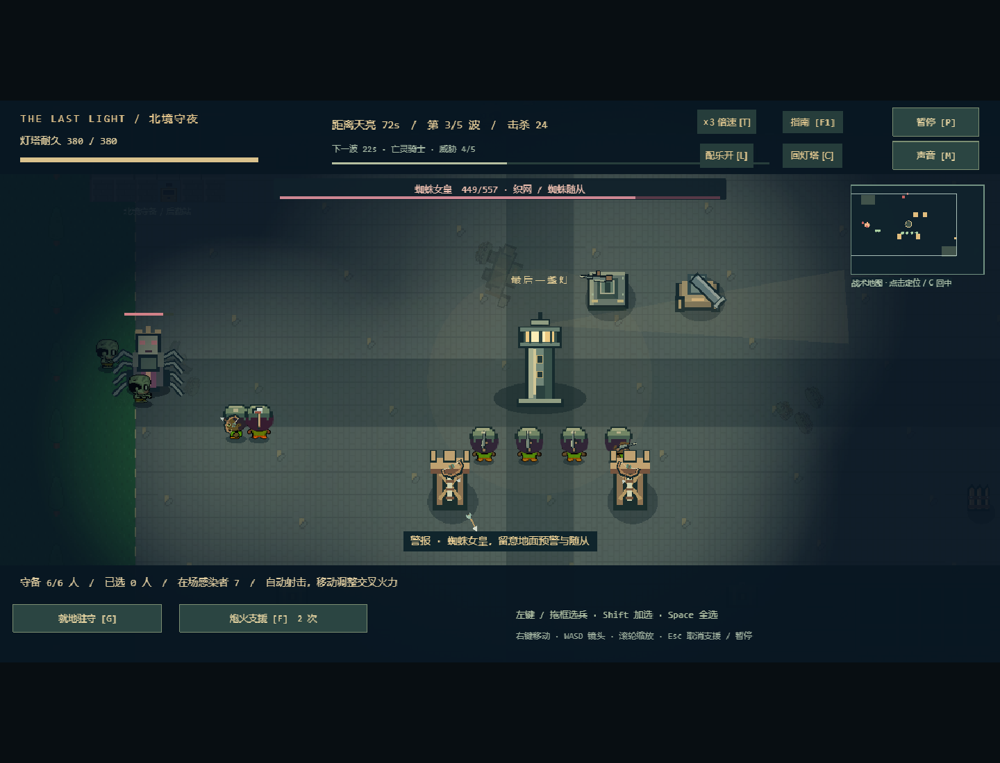
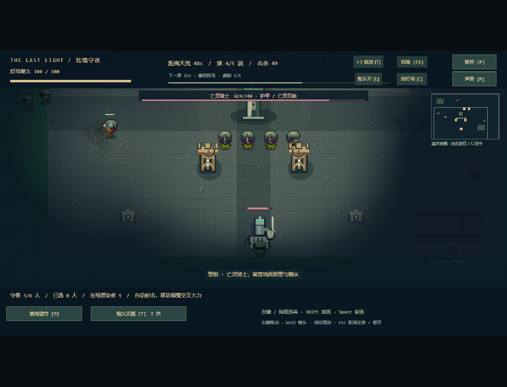
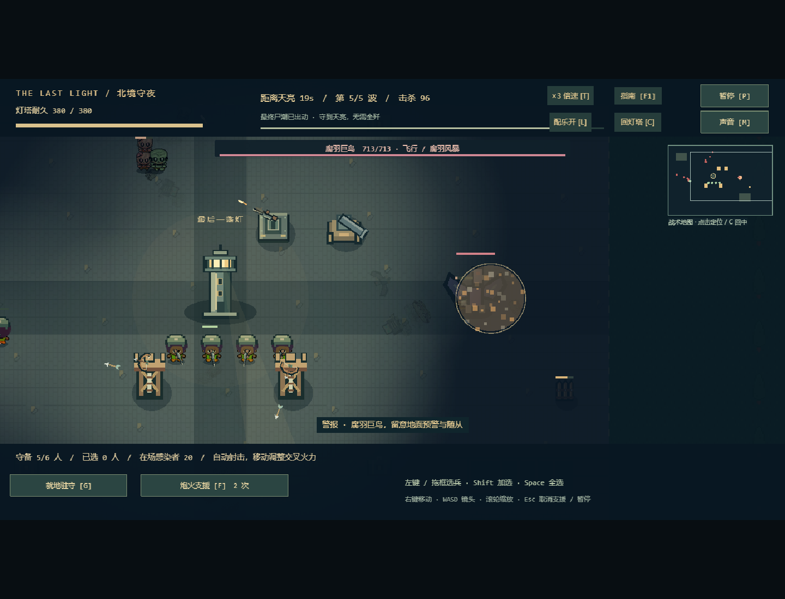

# v0.8 四大 Boss、渐强尸潮与变化街区

基于 v0.7 提交 `5b5600e`，分支 `codex/bosses-and-varied-expeditions`，验证日期 2026-10-24。落实用户追加的难度、Boss/随从、飞行目标、扩大基地和“每次变化一点点”要求；继续使用已有单昼夜、短时课堂展示和 Git 提交策略。

## 本轮内容

| 类型 | 机制 |
| --- | --- |
| 裂颅巨汉 | 第 2 波，475 最大生命；近处固定落点预警 0.95 秒后重斧范围攻击 |
| 蜘蛛女皇 | 第 3 波，557 生命；织网读条 1.1 秒，持续伤害/减速，召唤蜘蛛幼体 |
| 亡灵骑士 | 第 4 波，744 生命；25% 减伤，召唤 10% 轻甲的亡灵侍从 |
| 腐羽巨鸟 | 第 5 波，713 生命；飞越障碍，1.1 秒读条后腐羽风暴 |
| 普通敌人 | 游荡者、疾行者、重装、蜘蛛幼体、亡灵侍从、腐鸦，共六类 |

Boss 为原创三帧像素风 SVG 图集，包含腿部/翅膀动画、命中闪白和死亡图像。顶部显示名称、血量、机制；技能锁定时地面预警圈逐渐闭合，移动离开落点可避伤，击杀读条者会打断。已生成的网/风暴持续 5 秒，不随施法者死亡立即消失。

近战先锋/加农炮只打地面，机枪塔/箭塔/步枪兵/弓手可对空，F 支援也可命中空中目标。女皇和骑士第一次召唤延时 6 秒，之后每 8/10 秒召两名随从；召唤继承波次并检查落点与人数限制。Boss 并非只加大旧丧尸图片。

五波开始时间为 3/24/46/70/94 秒，计划数量 8/16/23/31/45，共 123 名，另有召唤；同类生命/伤害/速度随波次线性增加。最多同时 72 名敌人、160 弹体、8 个伤害区域、40 尸体、240 粒子。仍以守到 120 秒为胜利，无需全歼；T 三倍速约 40 秒完成守夜，音乐不加速。

基地世界 1792×1152，施工矩形 1280×768，约为旧施工面积 2.14 倍；原灯塔、集结点和旧设施坐标保持不变，后勤站与十字通道仍保留。可在旧边界以外建设，滚轮最低 0.55 倍，WASD/C/战术地图操作沿用。

每次创建探索有新种子，稳定城市中微调支线废墟、额外补给、部分室内箱子左右、医护/教官位置和三种街区色调。主路、门口、工具箱、步枪、工程师、信标、药房猎弓和弓手位置保持稳定。是少量可复现变化，尚未做完全随机城市或多日地图。

## 课堂短路线与人工验收

1. `npm run dev`，打开终端地址，默认直接进入探索。顶部显示街区主题和种子尾码；新出发/刷新后支线布局可能变化，主线目标仍可找到。
2. E 搜刮工具箱 (1056,736)、步枪箱 (1200,780)、急救补给箱 (1264,704)，营救工程师 (1104,852)，回信标 (920,760) 等队员汇合再 E。可得到 16 建材、2 电力、1 急救包（含工程师奖励），背包未超重。需要时边走边射击。
3. 回营 Enter 布防：机枪塔左上角 (832,352)；箭塔 (608,640) 和 (864,640)；R 旋转竖沙袋 (960,640)。建造键分别为 2、4、1，总成本 15 建材/2 电力。坐标仅供验收精确复现，普通试玩可按地形自行搭配。
4. Enter 提前入夜，T 可切三倍。第 2～5 波观察四位 Boss；WASD/滚轮移动镜头，C 回塔，F1 暂停查看机制。要仔细展示读条和调兵时先回一倍，选兵后右键离开预警圈。女皇/骑士旁观察蜘蛛/亡灵，飞行敌人不会被城墙阻挡。
5. F 在视野内密集敌群/重装附近呼叫有限支援。P 暂停后敌人、弹体、区域和计时均停止；恢复后继续。灯塔撑到 120 秒结算，Enter 用同一原阵地重试，不重复获取资源。无设施阵地应真实失守。
6. 可选去药房清敌、取猎弓、救弓手，或去便利店救先锋；已有可进入房间、武器和音乐保留。人工确认新 Boss 美术、提示可读性、难度和目标电脑流畅度；尚未宣称用户接受这些主观效果。

## 追溯

| 需求 | 实现 | 验证证据 |
| --- | --- | --- |
| R-43 Boss/随从 | config/night、NightWorld 生成/召唤、七份图集、BootScene | bosses.test 的编成/召唤/人数；bosses.spec 四 Boss 自然登场及三类随从 |
| R-44 技能/空地 | updateThreats、伤害入口、目标筛选/炮弹复核、NightView/NightHud | 移动躲重斧、击杀打断、真实织网/风暴、减速/过期/终局、越墙/对空规则；实机范围技能与暂停 |
| R-45 渐强/大地图 | levelStats、WAVES、config/base、动态尺寸视图/导航 | 属性/数量递增、扩展区域施工、旧档兼容；真实短路线胜利、六人五类防御三倍速胜利 |
| R-46 微变探索 | exploration-layout、ExpeditionWorld、CombatScene、MapView/Hud | 100 种子复现及全部箱子/NPC BFS 可达；浏览器新出发生成不同种子与摆位，关键位置稳定 |

## 实际测试与修正

| 检查 | 结果 |
| --- | --- |
| `npm test` | 56/56 通过，包含新增 9 项 Boss/地图规则与图集校验 |
| `npm run test:legacy` | 22/22 通过，旧版独立归档 |
| `npm run build` | 严格 TypeScript / 生产构建通过；JS 约 1.32 MB、gzip 361 KB，保留引擎大包提示 |
| 生产 Chrome 全套 | 25 项中 24 项通过；剩余为新 Boss 截图/终局快照比较的测试问题，随后专项修正并 2/2 通过；其余用例无需产品改动 |
| 真实正常流程 | 多搜一个急救补给箱，用真实库存完成四座设施，自动布防 30 秒、夜战 120 秒、指挥/支援/暂停/胜利/保存/重试通过 |
| 丰富存档实机 | 合法六兵种/足量库存夹具，真实点击建设与三倍速夜战；四 Boss、蜘蛛/亡灵/腐鸦、区域技能、胜利/终局冻结与对象预算通过 |

首次全套 23/25：新截图点击选到顶栏遮挡区域，另一个旧版五设施全部偏北的布局在新难度下真实失守。施工测试改用镜头内的扩展区域落点；布防测试把箭塔分布在南侧并增加第二座，花费从合法夹具库存真实扣除。第二次全套 24/25：新截图筛选距离过窄漏拍远处女皇。改用真实 WASD 镜头平移、可见性和安全屏幕范围拍摄；之后发现快照数组原地 sort 破坏预期对象，改为副本排序。最终 Boss 专项 2/2 通过，未降低四 Boss/胜利/暂停/冻结/对象预算断言，也未以改血或跳时接口绕过游戏。

提交前另核对暂存区的每项素材字节和 SHA-256，发现两份原许可证被 Git 换行规范化后与工作区原件不同；新增 .gitattributes 对 public/assets 禁止换行转换并重新暂存，全部暂存素材校验与清单一致，素材专项测试通过。这保证后续 Windows/Linux 检出保留原始字节。

产品检查修复：自定义三帧敌人停步不能取旧丧尸的方向帧编号；飞行悬停持续振翅。范围技能同帧摧毁灯塔与建筑时，终局清理已毁建筑，避免摘要算作仍然留存。读条者死亡先移出，再更新区域技能，避免死后发出尚未落地的技能。

`simulate:night` 规则模拟（同一 16 建材/2 电力/工程师/步枪起点，按脚本使用支援）：

| 布防 | 结果 | 时长 / 击杀 / 灯塔耐久 |
| --- | --- | --- |
| 无设施 | 失守 | 48.33 秒 / 21 / 0 |
| 单机枪塔 + 沙袋 | 失守 | 91.87 秒 / 62 / 0 |
| 机枪 + 两箭塔 + 沙袋 | 胜利 | 120 秒 / 127 / 338，四 Boss 击败 |
| 同上并调动部队 | 胜利 | 120 秒 / 127 / 293，四 Boss 击败 |

这些是固定策略的规则结果，不保证任意布局或玩家操作必胜。浏览器时间由 Playwright 虚拟时钟推进，游戏模型只读快照；不是人工听音、低配性能或其他浏览器评测。真实截图未修图，见下方；其余自动截图在忽略目录 artifacts。没有公网部署或远端 CI 验收结论。

