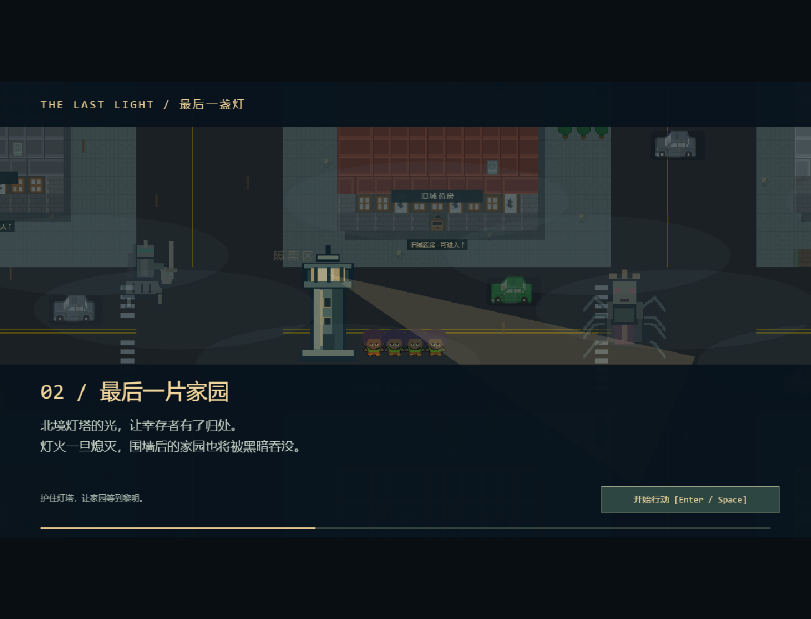

# v0.9 守灯人序章、提灯迷雾与容量调整

基于 `b943f3f`，开发分支 `codex/story-lantern-and-fog`，验收日期 2026-10-25。用户要求取消建筑数量上限、扩大背包，补充背景与开场动画，探索时有身边灯光/迷雾和亮度道具，并在出发/返营时增加转场。

## 背景和目标

黑雾吞没了旧城，感染者和异变巨兽在雾中游荡。北境灯塔为幸存者留下最后的家园，灯火一旦熄灭，家园也将被黑暗吞没。玩家是守灯人，白天带灯寻找补给、武器和幸存者，黄昏将收获变成防线，夜晚指挥守军抵御尸潮，坚持到黎明。

首次默认入口播放三幕序章，每幕约 3 秒：黑雾之后 → 最后一片家园 → 你是守灯人。使用现有城市、人物、怪物和灯塔素材，带横移雾层、旋转灯束、人物步行动画、镜头和字幕变化。此时探索世界尚未建立，不消耗探索预算。

Enter / Space / Esc 或按钮随时开始行动，播完也自动开始；失焦/切后台暂停，P 或点击画面恢复。同一标签页记住已观看，刷新不强制再看，`/?intro=1` 可重播。存储禁用时仍可正常跳过/开始。原战斗、布防、夜战练习入口仍可直接使用。

## 探索灯光与道具

| 内容 | 当前行为 |
| --- | --- |
| 基础提灯 | 半径 240 像素，角色身边有实际提灯与暖光 |
| 聚光镜片 | 街边金色箱 (1152,688)，E 搜刮后升级到半径 320；无资源负重 |
| 高能灯芯 | 药房室内储藏箱 (1024,432)，同时取得猎弓、补给与灯芯，升到半径 400 |
| 遮挡 | 墙/车辆等真实碰撞矩形遮挡灯光，从门洞可照见室内；升级不能穿墙透视 |
| 记忆 | 未探索区域黑雾遮住，走过后留暗色地形，不持续显示离开视野的活物 |
| 小地图 | 只显示已探索地形、已发现补给，敌人/NPC 仅当前可见；任务方向和信标为已知情报 |
| 保存 | 道具即时生效，但成功返营/黄昏收队才保存灯级；死亡不带回新升级，旧档按基础灯读取 |

低级镜片不会把高级灯降级，同一箱只领取一次。药房补给仍是整箱领取，背包满时整箱保留，灯芯也不提前发放；纯镜片没有负重，即使资源背包满也能领取。视野地形记忆只在本轮探索保留，没有新增探索中途存档。

遮罩约每 0.1 秒更新，以同一模型的可见/已探索网格驱动半分辨率画布，边缘柔化后上传。敌人、人物、物资图片和标签显式按可见性隐藏，不只靠半透明遮罩遮住；避免已探索暗区泄露仍在移动的怪物。灯光目前用于城市探索，基地/夜战保留已有灯塔、士兵与炮塔软视野规则。

## 容量与转场

背包从 24 增为 48，建材/电力重 1、急救包重 2，仍然按整箱原子领取，超出容量时不扣物品、不吞奖励。营地累计库存与背包本轮负重继续分开。

施工、合法阵地存档和夜战摘要一起取消原 40 座判断，HUD 不再显示 `/40`。实际仍需费用和合法网格，重叠、越界、通道、士兵脚下/目的地及围困施工继续拒绝；没有变成免费建设。规则与实机都验证了 60 段城墙及真实花费、保存/刷新和超过 40 的结算。

出发“提灯出发”、返营“灯火接应，队伍归来”、进入基地“回到家园，筑起防线”、入夜“黑雾将至，守住灯塔”各有约 0.7 秒叠化。动画与当前阶段并行，不锁操作，不增加强制等待或改变三倍速规则。暂停/背包/指南会隐藏叠化，避免遮住正在阅读的面板；已结束世界依然冻结模型和结算，不以动画推进战斗。

## 人工验收

1. `npm run dev`，打开终端地址。首次看三幕序章；试 Enter 或 Space 跳过，或等待自动开始。切走窗口再回来应暂停，点击/P 可恢复。需要再次展示时用 `/?intro=1`。
2. 开始后看顶部“提灯 0级 / 240”和背包 `0/48`。远处地图应被雾遮住，镜头缩小也不会全图透视；移动会揭开身边区域，走远后留下暗色地形。
3. 在工具箱东北侧 (1152,688) 找到金色镜片箱，E 后观察亮区扩展、顶部 1级/320。靠近墙体或绕过车辆，视线应受实际障碍影响；小地图只逐步显示发现的内容。
4. 可去药房南门 (1072,512)，清敌后在室内 (1024,432) 领取猎弓/灯芯，看 2级/400。门外看不到墙后的全部人物；走进门后才显现。旧版武器/营救玩法继续工作。
5. 回信标 (920,760) E，观察归来叠化，Enter 进基地看家园叠化，再正常布防/入夜。不必等待转场结束才能按键。安全返回后再出发应保留灯级；失败则不保留本轮刚拾取的升级。
6. 用资源允许的阵地持续建墙超过 40 座，检查扣费、非法占地拒绝和刷新保存。可额外带回更多物资，背包超过旧 24 仍能搜刮，达到 48 后整箱拒收。
7. 试玩判断序章表达、视野亮度、迷雾边缘、敌人接近时的反应时间，以及目标电脑在较多建筑下的流畅度。自动化没有代替主观接受。

## 需求、实现、验证追溯

| 需求 | 实现 | 证据 |
| --- | --- | --- |
| R-47 背景序章 | config/story、PrologueScene、BootScene | 空会话三幕、失焦暂停、自动开始预算、已观看记忆、禁用存储跳过 |
| R-48 探索迷雾 | ExplorationVision/Fog、ActorView、ExpeditionView、Hud | 当前/记忆分离、墙体遮挡/门洞、边界校验；实机模型可见敌人与实际精灵显隐数量一致 |
| R-49 提灯 | Cache.lampLevel、ExpeditionWorld、Campaign 校验 | 两级即时增亮、不降级/不重复、满包镜片、成功持久化/失败丢失、旧档默认与非法灯级拒绝 |
| R-50 容量/施工/转场 | CAPACITY、BaseWorld、validBasePlan、NightResult、SceneTransition | 48 容量和超重原子性；60 座合法施工/读档/夜战摘要；真实返营保存及叠化开始/结束 |

规则新增 `tests/vision.test.ts` 六项；浏览器新增 `tests/browser/story-and-fog.spec.ts` 四项。既有案例通过 `fixtures.ts` 模拟同标签页“已看过序章”的正常偏好，专门序章案例从空会话实际播放；不以 `test=1` 绕过玩法或更改血量/速度。只读 `presentation()` 与冻结的世界快照分开，避免把表现层叠化进度混进战斗幂等断言。

| 检查 | 实际结果 |
| --- | --- |
| `npm test` | 62/62 通过，包括新增六项和提灯素材/许可 SHA-256 检查 |
| `npm run test:legacy` | 22/22 通过 |
| `npm run build` | 严格 TypeScript 和生产构建通过，JS 约 1.33 MB / gzip 365 KB，保留引擎大包提示 |
| 新增实机专项 | 4/4 通过，约 11 秒；真实键鼠、虚拟时钟，不修改模型 |
| 最终生产 Chrome 全套 | 29/29 通过，约 3 分钟；完整昼夜、Boss、室内/护送、暂停/异常存储与全部四项新增功能均通过 |

没有公网部署或远端 CI 结论。序章/迷雾/转场为当前桌面键鼠实现，没有加入多日、复杂对话或全程电影；建筑数量取消限制也不等于任意规模已作性能保证。阶段时长保持 90/30/120 秒和塔防三倍速。

已目视检查最终生产截图：序章灯塔/怪物与幸存者均在画面内，字幕无截断；提灯轮廓可辨，雾边柔化，近处敌人可见而远处不显示；家园叠化与六十段墙布局正常。代表图原样复制到 docs/screenshots/story-home.png、lantern-fog.png、home-transition.png、sixty-walls.png。自动化使用虚拟时钟推进，不代替人工听感/手感或目标电脑性能评测。
