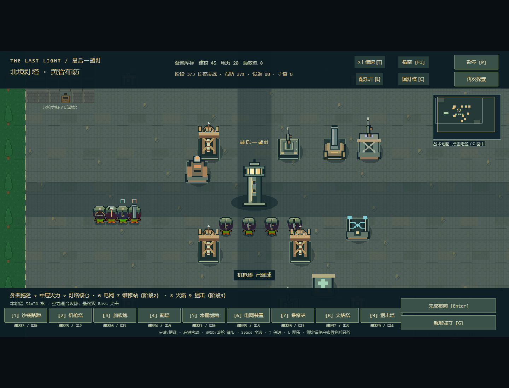
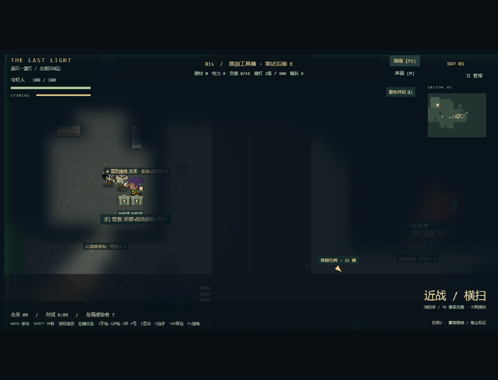
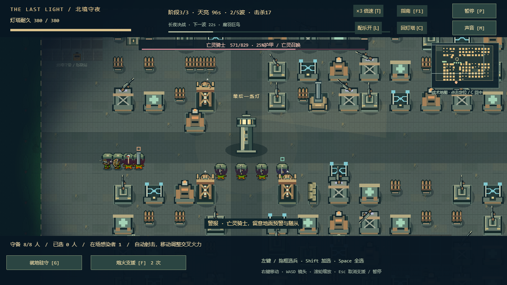

# v0.10 三阶段守灯战役

## 审查与范围

已阅读 README、架构/设计/测试及 v0.7–v0.9 交接资料，核对 campaign、expedition、base-world、night-world、地图、视图、输入和规则/浏览器测试。修改前 `npm test` 62/62 通过。现有问题是同一夜固定四 Boss 全出，胜场只作统计；五种设施全部开局开放；既有扩大基地没有内容解锁联系，人物仅五种，建筑资产外形与底座缺少统一标识。

P0：沿用 90/30/120 秒循环，做三个守夜阶段、逐阶段面积/设施/搜救/Boss 解锁、四种定位设施、两种机制 Boss、一个普通专家和两位英雄，以及基地与战斗反馈统一。P1：更多英雄/事件、独立防空塔、更复杂组合、长期战役和全量重绘暂缓。保持 Phaser/TypeScript/Vite 与纯模型测试结构。

实施分为成长和战斗模型、视图/素材和交互、验证/性能和文档三个增量。

## 成长与保存

使用三个 120 秒守夜阶段，首次胜利推进，失败可用入夜检查点重试。每阶段首次胜利给有限建材/电力补给，重复胜利不重复发奖。第三阶段以后不无限提高数值。继续探索后重新布防才能进入已解锁的新阶段；结算 Enter 重试原阶段。旧 v2 存档缺少成长字段时从第一阶段开始，原库存、名单、灯级、坐标和阵地保留。`nightsWon` 继续作历史统计，不用旧胜场偷偷跳过教学阶段。

| 阶段 | 可施工区域 | 计划敌人数（含Boss，不含召唤） | Boss | 首胜补给 |
| --- | --- | --- | --- | --- |
| 1 余烬初守 | 1280×768，40×24格 | 59 | 第5波巨汉 | 12建材 / 4电力 |
| 2 雾潮围城 | 1472×928，46×29格 | 104 | 第3波女皇、第5波喷毒者 | 16建材 / 6电力 |
| 3 长夜决战 | 1728×1088，54×34格 | 154 | 第2波骑士、第3波巨鸟、第4波自爆怪、第5波女皇+喷毒者 | 20建材 / 8电力 |

每夜维持五波和120秒；波内最多增加32%生命、24%伤害、10%移速。跨阶段另乘生命1/1.14/1.28、伤害1/1.12/1.24、移速1/1.035/1.07。前期没有飞行杂兵，中期少量腐鸦，后期空地、护甲和召唤混合。首胜物资有上限，不能靠重试刷取，玩家仍需继续白天搜集电力和建材。

`clearedStage` 为已通关最高阶段（0–3），`BasePlan.stage` 固定入夜检查点，`lastNight.stage` 记录本次结果。重复调用 `resultCampaign()` 返回同一结算；重试读取原阵地阶段，首胜判断使用已通关记录。历史 `nightsWon` 仍记录实际胜利次数。营地保存仍是同一个v2 JSON原子写入，未增加第二份成长存档；旧版角色、灯级和坐标校验继续有效。战损不持久扣掉已购买阵地，失败仍可反复尝试。

## 扩建与操作

世界1792×1152增至2048×1408，寻路网格从56×36增至64×44，约增加40%。最终施工面积比首阶段增加91.25%，不设置设施数量硬上限。灯塔和旧设施坐标不动，旧十字通道向新边界延伸。四个敌军入口随阶段向外移，不能把外围新增区域建在敌人出生点外面失去作用。

新增区域仍走网格、重叠、库存、脚下、部队目的地和困兵检查；仅合法建造后扣费并重建导航。所有阶段沿用原编队、碰撞、建筑摧毁重建路径。缩放最低0.5，WASD移镜头，C回灯塔，小地图显示当前施工边界并只负责定位。底栏保留1–5原设施，6电网、7维修、8火焰、9狙击；锁定内容显示解锁阶段，模型和UI同时阻止提前施工。

## 四种新增设施

下表为原价；工程师使每座少耗1建材（最低1），电力不打折。所有新设施占64×64。

| 设施 | 解锁 | 建材/电力 | 耐久 | 射程 | 实际机制与取舍 |
| --- | --- | --- | --- | --- | --- |
| 电网 | 2 | 6/3 | 110 | 150 | 地面范围每0.6秒4伤害，45%减速0.9秒，不叠加减速倍率；伤害低，需配合火力 |
| 维修站 | 2 | 7/3 | 125 | 180 | 每3秒恢复其他存活设施8耐久，封顶；不修自己/灯塔，不复活废墟，无攻击 |
| 火焰塔 | 3 | 8/3 | 140 | 145 | 地面范围每0.3秒12伤害，视线受静态墙体阻挡；射程短且不能对空 |
| 狙击塔 | 3 | 10/4 | 85 | 520 | 真实弹体115伤害/2.4秒，对空/地，优先Boss；造价高、脆弱，清群不如机枪/火炮 |

机枪仍有最高的近中程单体射速；箭塔不耗电；加农炮范围爆炸；低价城墙和沙袋用于拖延。新设施补充控制、阵地维持、清群和远距单体定位，没有增加万能塔。

## Boss和搜救

保留巨汉、女皇、骑士、巨鸟，移到不同阶段。`config/night.ts` 集中配置生命/速度/护甲/对空属性、技能范围/读条/半径/冷却与各阶段波次。

- 蚀雾喷吐者：第二阶段开始出现。360距离锁定守卫/设施落点，1.1秒读条，92半径毒池持续5秒、每0.5秒伤害一次；第二/三阶段每次4/5伤害。落点锁定后调兵可躲开，不能只依赖近战堵口。
- 熔囊巨怪：第三阶段第4波。靠近100距离后，原地1.6秒读条，125半径自爆；伤害95再乘波次/阶段系数。击杀可打断，自爆后消失而不记作玩家击杀。减速持续时间在蓄力时仍正常流逝。
- 所有Boss保留预告、登场警报、血条和技能说明、落点圈/交叉标、死亡粒子。限制最多72敌人、160弹体、8危险区域；女皇和骑士召唤仍受总数限制。

| 人物 | 解锁/位置 | 实际作用 | 取舍 |
| --- | --- | --- | --- |
| 电工许舟 | 阶段2，东北供电管理内(1824,352) | 护送返营额外3电力；每轮仅结算一次 | 路远，占用白天时间 |
| 英雄苏禾·战地医师 | 阶段2，西北维修站内(352,368) | 夜战增加医师守卫；180范围每6秒治疗10，不复活；手枪10伤害/0.9秒 | 输出低，需靠近前线发挥治疗 |
| 英雄韩烬·重火力 | 阶段3，东南旧公寓内(1824,1168) | 夜战增加重炮手；55伤害/1.2秒、52爆炸范围、290射程 | 移速100（其他140），不能对空 |

两位英雄首次营救各触发最多两名额外感染者，仍受16名室内/伏击上限、合法落点约束；维修站额外工程箱提供6建材/4电力。这是小型高风险搜救，没有剧情树。已经安全返营的英雄不再重复出现在后续街区，也不会重复生成守卫。总守备上限8人。白天英雄沿用现有护送模型，战斗专长在夜间生效；白天NPC仍不受伤。

## 美术审查和实现

原角色是40像素人物、Boss为96像素三帧矢量条，既有尺度体系保留；没有全量重绘。新增六份网格矢量素材使用既有青灰轮廓、锈黄结构和少量功能色，三帧Boss有独立轮廓：喷毒者偏斜头部/毒囊，自爆怪突出笼状熔囊。素材生成脚本、CC0声明和SHA-256清单一并保留。

所有设施新增统一金属地台、边框和功能色条，选中/施工时显示真实范围。地面加青灰污渍/接缝；英雄用色调和菱形标记，Boss脚下威胁环；电网青色脉冲/减速脚环，火焰锈橙扩散，毒池灰绿、爆炸橙色、风暴紫色。沿用暖灯/冷雾与Consolas/微软雅黑UI。探索、布防、守夜、结算均显示阶段，结算说明首胜奖励与下一步解锁。

## 代码追溯

| 文件 | 修改目的 |
| --- | --- |
| src/config/progression.ts、survivors.ts | 三阶段定义和角色资料，供模型与UI共用 |
| src/config/base.ts、night.ts | 施工尺寸、设施、Boss、技能与阶段编成 |
| src/core/campaign.ts | 兼容v2，校验新增字段、角色和8人阵地 |
| src/core/base-world.ts | 解锁/施工范围、英雄招募、检查点阶段 |
| src/core/night-world.ts | 减速/维修/范围攻击、Boss技能、英雄战斗、首胜幂等结算 |
| src/core/expedition.ts | 分阶段人物/补给、英雄伏击、护送与电力奖励 |
| src/scenes/BaseScene.ts、BootScene.ts | 输入、阶段转场和素材载入 |
| src/view/BaseHud.ts、BaseView.ts、NightHud.ts、NightView.ts、Hud.ts、ExpeditionView.ts、FieldGuide.ts、TacticalRadar.ts | 阶段、范围、边界、战斗效果和视觉统一 |
| tests/progression.test.ts、tests/browser/progression.spec.ts | 成长、存档、设施、Boss、英雄和键鼠验收 |
| scripts/simulate-progression.mjs、measure-base-performance.mjs | 三夜模型评估、120设施/72敌人压力和真实浏览器采样 |

## 演示路线

1. 新营地：跳过已了解的序章，走工具箱(1056,736)→步枪箱(1200,780)→急救箱(1264,704)→工程师(1104,852)→信标。可取得16建材/2电力。进入布防，演示6–9设施锁定。
2. 第一夜：机枪(832,352)、箭塔(608,640)/(864,640)、旋转沙袋(960,640)；Enter提前入夜，T两次三倍速，展示首阶段只来巨汉。结算说明首胜补给。Enter只重试原阶段；推进需点返回城市。
3. 第二次白天：可先取补给和电池，再沿道路到西北维修站救医师。推荐经过(624,720)→(624,592)→(272,592)→(272,528)→(272,432)→(352,368)，从南门进出，战斗清理门内感染者，护送回信标。白天可暂停F1讲解。
4. 第二阶段：新增电网(1024,576)、维修(928,736)、加农炮(960,352)，展示扩大边界、维修和治疗。女皇第3波、喷毒者第5波，分散守兵躲地面提示。
5. 第三阶段：继续探索补充资源，可到东南公寓救重炮手；补火焰(576,416)、狙击(1056,352)、南部机枪(832,800)。缩小镜头/小地图查看更大布防区，展示飞行/自爆/末波双Boss。三阶段全部三倍速的夜战合计约2分钟，探索/布防/讲解另留时间，完整展示建议6–10分钟。

## 后续候选与边界

优先收集课堂目标设备的手感/难度反馈，再调数值。更多英雄、主动技能、专门防空塔、复杂事件、更多战役阶段和全量人物/Boss动画重画留到后续，避免本轮把每个方向都做成半成品。当前英雄AI仍是自动攻击/范围治疗，无装备树；战后阵地恢复是为可反复演示作出的取舍。未新增联机、账号、后端、随机开放世界或大型重构。

## 阶段交付与验证记录

- `1cac021`：成长配置、兼容存档、扩建和新战斗模型，新增规则测试。目的是先以纯模型证明解锁/奖励/战斗行为；风险集中在旧存档和结算重复，使用往返/首胜/重试测试覆盖。
- `90bf030`：阶段/设施UI、原创素材、范围和战斗反馈、真实键鼠浏览器验收。风险集中在HUD遮挡/镜头、资源扣费、素材缺帧，使用施工/指挥/存档和五Boss整夜专项覆盖。
- 最后一批收尾包含Boss技能参数集中、蓄力期间减速正常到期的修正，性能脚本、CI模型烟测和设计/需求/测试/素材文档。所有提交均为本次工作产生的真实本地历史。

验收中遇到的问题与修正：喷毒者最初使用了旧的230索敌距离，已统一到配置中的360，并验证锁定守卫、毒池伤害和移动躲避；减速状态最初在Boss蓄力时没有递减，补充回归后修正。浏览器新增用例中曾把世界y=800的施工点点到底栏、以及在画布外按下鼠标导致没有开火，分别修正为真实移镜头和先把鼠标移入画布；不降低战斗血量或修改诊断接口以通过测试。

完整回归还暴露测试稳定性问题：90秒自动收队用例在并行Chrome下可能超过原90秒墙钟预算，该用例超时提高到180秒，完整60秒场景默认墙钟预算提高到120秒，保留全部模拟时长和战斗断言；英雄用例直线经过可随机生成废墟的支路，改走固定主路，没有删除地图障碍或固定随机种子。

## 性能和可玩性评估

可复现命令：`npm run simulate:progression`；另启动4173端口生产预览后运行`npm run measure:base`。原始记录见[performance-v0.10.json](performance-v0.10.json)。本机独立采样结果：

| 场景 | 实际结果 |
| --- | --- |
| 三夜参考阵地连续模拟 | 全部120秒胜利，计划建筑4→8→14，战后留存4→8→11；击杀59/107/158（含召唤），最终生还守卫7/8；参考方案有增长余量，不代表玩家不用操作即可必胜 |
| 120设施、初始72敌人合成模型压力 | 600固定步，平均1.19ms/步、P95 1.54ms、最大7.43ms |
| 120设施、8守卫生产Chrome，真实8秒、三倍速 | 帧间隔平均6.08ms、P95 6.2ms、最大18.1ms；模拟推进约24.1秒，未捕获页面错误 |

浏览器使用合法富资源阵地做设施渲染压力，火力很强，采样结束仅1名在场敌人、17具尸体；**它不是同时渲染72敌人的帧率承诺**。72敌人压力由模型夹具单独覆盖。完整战役浏览器测试另外覆盖五Boss、召唤、技能、粒子/尸体/实体上限。虚拟时钟测试时长不用于计算帧率。低配或课堂设备、主观难度与手感仍需现场试玩。

可玩性依据：真实短路线16建材/2电力可建立首夜防线，无设施模型约86秒失守；继续探索和有限首胜补给可支撑逐阶段增建。新区域真实键鼠施工、行军、定位和刷新已专项验证。当前方案重在课程展示中可理解的三阶段层次，暂不模拟永久战损或超长战役。

## 自动化结果

规则/素材测试76/76、旧版规则22/22通过；TypeScript和Vite生产构建通过。Git已提交的42份素材/许可逐项与manifest字节数及SHA-256一致。新增成长规则包括三个阶段、一次性奖励/重试/兼容、四种设施、两种Boss、两位英雄/电工和多种子可达性。

生产JS约1,339.65 kB，gzip约369.44 kB；仍有Phaser引擎大包提示，没有忽略或伪称消除。构建能作为静态站点运行，本轮未推送部署或验证远端CI。CI加入三阶段模型烟测。

最终对`index-BRNWdiu3.js`生产构建运行完整Chrome套件：**32/32通过，约5.1分钟**。包含原完整昼夜、90秒自动收队、实际失守/存储禁用、输入/指南/镜头/迷雾，以及新增首胜→探索→阶段2、英雄进屋营救护送/刷新、扩大区域施工行军、最终五Boss/双Boss/暂停/胜利。没有降低断言或改变战斗属性以绕过失败。

已目视检查并原样保存后期阵地、英雄搜救、新Boss、扩建区域、120设施和最终胜利实机截图。最终版本的测试入口仍只读，正常入口不暴露诊断接口；未作人工手感认可或低配设备保证。
