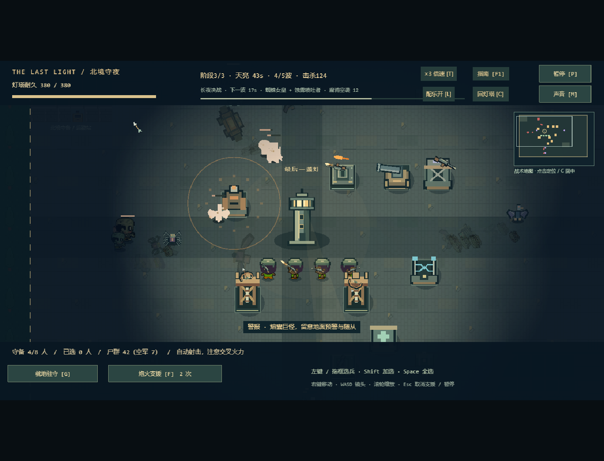
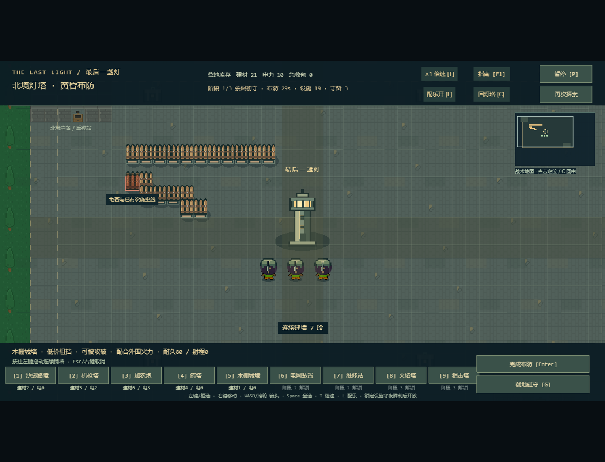
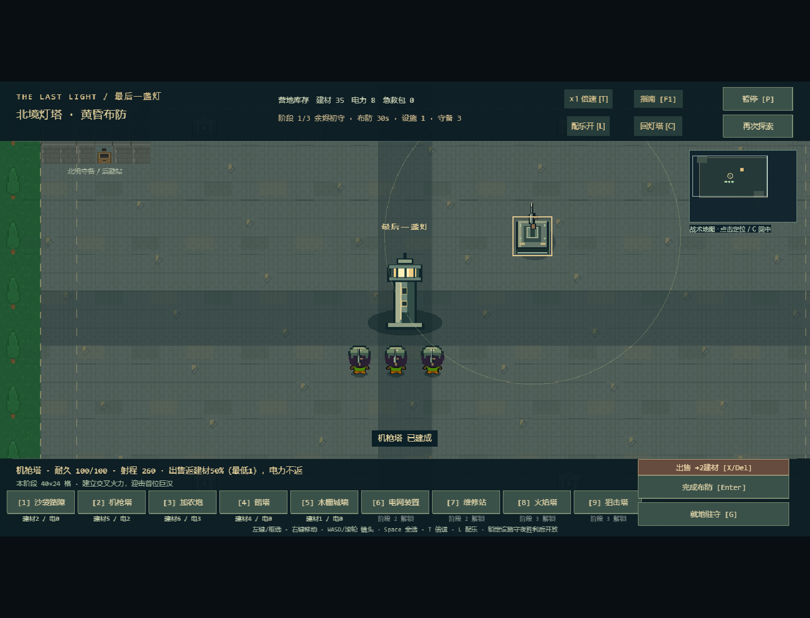

# v0.10.1 尸潮压力与布防操作

2026-10-26。基于玩家反馈“敌人未接近就死、空军少、城墙逐段点击太慢、出售不直观”进行小幅调整，保持三阶段、原存档和120秒夜战。

## 本轮行为

| 项目 | v0.10 | v0.10.1 |
| --- | --- | --- |
| 三阶段计划敌人数（含Boss，不含召唤） | 59 / 104 / 154 | 100 / 162 / 230 |
| 刷新方式 | 单只，杂兵按种类排队 | 每0.9/0.8/0.72秒一批3/4/5只，多路混编穿插 |
| 空军 | 首夜没有，中后期少量 | 首夜第2波即来腐鸦，各阶段共14/25/40只腐鸦，后期仍有飞行Boss |
| 腐鸦 | 35生命、68速度 | 54生命、76速度，不再两发普通机枪弹就消失 |
| 波内成长 | 生命每波+8%、速度+2.5% | 生命每波+10%、速度+3.5%；伤害增幅保持原值 |
| 跨阶段成长 | 生命每阶段+14%、速度+3.5% | 生命每阶段+18%、速度+5%；伤害增幅保持原值 |

Boss解锁顺序不变，没有把所有Boss放回首夜；在场仍最多72敌人、160弹体、8危险区域。预告显示腐鸦空袭数量，开波会提示对空威胁，底栏显示当前空军数。目标是让集群抵近、空地搭配产生压力，保留短路线认真布防后可通关的余地。

## 连续铺墙

黄昏按5或点城墙按钮，**按住左键拖动**即可连续铺设。快速横划/斜划会补齐中间格子，转角四方向连通；反向划回使用相同网格，重复走过不重复扣费。每格仍调用原建造校验和真实扣费，重叠、十字通道、脚下、目的地、越界或困兵的格子不建；预算不足不透支。合法格子当即建成，一批操作后原子保存库存和阵地。

松手、离开画布、拖到HUD、暂停/失焦、打开指南、Esc/右键、切换工具、回灯塔/小地图跳转、入夜均停止当前笔划。不会在恢复后沿旧起点意外补一条墙。WASD正常平移镜头时可继续用笔划铺设。

## 出售

黄昏左键选中设施，右下出现**出售按钮**和实际回收数字；也可按X或Delete。回收实际支付建材的50%向下取整，**最低1建材**，电力不返。工程师折扣后的实付费用参与计算，1建材城墙回收1，不能靠买卖赚取资源。删除设施后重建导航并保存，重复出售同一ID无奖励；暂停、指南、入夜和终局不可穿透出售。

## 关键文件

- `src/config/night.ts`：波次、空军、刷新批次与成长数值。
- `src/core/night-world.ts`：杂兵混编队列与有界批量进场。
- `src/core/wall-stroke.ts`：可逆、补齐中间格子的连续笔划。
- `src/core/base-world.ts`、`src/config/base.ts`：逐格施工、出售回收。
- `src/scenes/BaseScene.ts`：鼠标拖建和中断、出售按钮/快捷键、空袭通知。
- `src/view/BaseHud.ts`、`NightHud.ts`、`FieldGuide.ts`：操作说明、售价与空军提示。
- `tests/assault-and-walls.test.ts`、`tests/browser/assault-and-walls.spec.ts`：规则及真实键鼠回归。

## 验证与取舍

三阶段参考阵地（4→8→14座设施、按阶段救人、有两次支援）实际模拟结果：全部守到120秒；同场敌人峰值20/33/55，最终阶段灯塔324/380、守军4/8、设施9/14。旧版同场峰值14/24/34。只建机枪和沙袋的首夜参考阵地可通关，但守军全灭、灯塔340；不是所有合理阵地都必定无伤，也没有将敌人调整到无法通关。

新增规则验证笔划连通/可逆、快速补格、回划不重扣、库存不足、保留通道/困兵、夜间限制、出售不可重复获利、首夜空军和72敌人上限。三阶段模拟另增加后期至少40敌人同时逼近的密度回归。

有意保持：只对城墙连续施工，其他设施仍单击；夜间仍不施工或出售；不新增建筑、兵种或Boss，不增加超出72的在场上限。旧存档无需迁移，刷新网页再开始一夜即可使用新编成。胜利后返回城市探索推进阶段，Enter仍是重试本阶段。

最终规则/素材82/82、生产Chrome全套35/35通过（约3.9分钟），TypeScript/Vite构建和三阶段模拟通过；生产入口对应`index-DQ7UCneV.js`。新增实际键鼠用例验证横竖/斜拖、回划/停留、暂停/取消、保存刷新、通路与出售；原主流程、守夜、Boss、迷雾和存储异常继续通过。构建仍有既有Phaser大包提示。

验收中发现旧基地用例在同一帧连续发送P/Enter偶发未完成布防，改为先推进70ms并断言已恢复，再发送Enter，保留原全部断言；未降低战斗属性来通过测试。数据原样摘录见[assault-v0.10.1.json](assault-v0.10.1.json)。实机截图已目视检查；本轮不把自动化结果当作人工手感认可，后续仍可按实际试玩反馈微调。

