# 《最后一盏灯》v0.11 交付与试玩

## 本地基线与执行顺序

从干净的本地 `codex/story-lantern-and-fog` / `3278b6b88a92820a58ce2e7e86dfc9d5231fd1c3` / v0.10.1 开始，没有拉取远端或覆盖本地v0.10成长代码。先完成围城调度，再完成演出与浏览器验收，之后才实现城市模块和两种炮塔改装。

第一批提交：`d9f1c69`（敌潮与性能）、`9212113`（演出、交互修复、截图与验收）。第二批提交`cdeb73f`（城市模块和炮塔改装），后续补充可选危险地点武器奖励与最终验收。第一批详细诊断、前后对照与原始指标见[18-v0.11-siege](18-v0.11-siege.md)。

## 为什么原来缺乏压力与演出

基线源码 `src/config/night.ts` 已经有72敌人上限与3/4/5批次，不能沿用更早版本结论。基线 `NightWorld.step` 逐单位轮转四口，使每个方向兵力稀释；94秒末波与2048×1408地图行军距离不匹配，部分慢速敌人在120秒黎明前难以接敌。`NightView.update` 完全隐藏视野外敌人。重跑原参考阵地得到峰值20/33/55，前两阶段灯塔满耐久，说明主要问题是攻势组织与可见压力，而非应把生命伤害翻倍。

基线 `SceneTransition.ts` 是0.7秒、78%全屏暗罩加文字上移，没有镜头、世界光照、警报声层或结算前战场余韵。原地图生成器只有最多4个小障碍、±8像素位移、室内箱子左右摆位，房屋、门洞与道路完全固定。九种设施虽有真实不同功能，但缺少后期专精取舍，升级外观、损坏表现和炮管后坐不足。

这些旧实现可用 `git show 3278b6b:src/core/night-world.ts`、`:src/view/SceneTransition.ts`、`:src/core/exploration-layout.ts` 复核；当前文件已完成改造。

## 最终机制和主要文件

| 体验 | 实现 | 主要文件 |
|---|---|---|
| 密集且变化的夜战 | 阶段威胁预算、成团双接敌线、侧袭、提前高潮、后期四向；首夜稳定教学、后期种子侧翼；普通/困难 | `core/assault.ts`、`config/night.ts`、`core/night-world.ts` |
| 有效接敌和破墙 | 空间分桶目标/弹道/邻居；正常流场与静态攻城流场结合，受阻重装扩大缺口，建筑损毁后重算 | `core/spatial.ts`、`core/night-world.ts` |
| 战场反馈 | 真实外围敌人轮廓、四向警报、多线告急、裂纹/碎石/后坐、暖灯束，粒子/尸体有界 | `view/NightView.ts`、`BaseView.ts`、`NightHud.ts` |
| 连续场景演出 | 出发、归来、入夜、Boss、黎明、失守，1.25–2.7秒；真实地图、镜头、雾、光束、低频合成音；Space跳过，V减少动态 | `view/SceneTransition.ts`、`SoundBus.ts`、`scenes/BaseScene.ts`、`CombatScene.ts` |
| 可维护的半随机城市 | 三套外围房屋尺寸/门位/街垒模块，三类可选危险补给事件；房内资源、救援地点随种子变化，教学线/药房稳定 | `core/exploration-layout.ts`、`expedition.ts`、`config/map.ts`、`view/MapView.ts` |
| 后期战术专精 | 机枪→双联高射炮，仅对空群伤；加农→重型榴弹炮，慢射速远程地面群伤；U或按钮改装，真实扣费、阶段锁、读档、维修及出售 | `config/base.ts`、`core/base-world.ts`、`night-world.ts`、`view/BaseHud.ts` |

双联高射炮另付6建材/2电（工程师减1建材），340射程、28伤害/0.65秒、56范围破片、125耐久，失去对地能力。榴弹炮另付10建材/4电，460射程、110伤害/3.2秒、100范围、145耐久，仅对地。只做这两种改装，没有新增英雄、Boss或重复已有设施。费用单独记录，出售按累计实际支付建材的一半回收，电力不返；反复U不能再扣费。

仍用原存档键和version2。改装字段、探索摘要seed均可选；旧档不需迁移覆盖。安全返营记录seed；探索中途刷新继续沿用原来的“本轮未保存”规则。背包48、阶段奖励和夜战检查点不变，不设建筑数量硬上限。

## 验证和性能

规则90/90、旧版22/22、严格TypeScript与生产构建通过。300个末阶段地图种子逐一验证所有箱子、人物、门洞可占据且连通回营；覆盖三套结构和三类事件。另有原100种子回归。危险地点额外提供步枪或猎弓，通过真实互动和容量规则取得，返营入库；教学武器地点保持稳定。浏览器实际步行三个种子的仓库门口和室内，实际库存改装、刷新、暂停、实弹和失守重试均通过。

第二批完整生产Chrome回归由Playwright托管预览后40/40通过，用时7.4分钟（源码`cdeb73f`）。此前一次外部预览进程中途退出，18项通过、22项连接拒绝，失败日志保留，没有计作通过。最后可选武器奖励提交`a85a90e`在最终生产构建上追加城市/改装/演出3/3回归（57.8秒），规则增至90项。最终构建产物`index-Dr-HRap1.js`。完整日志`artifacts/v011-managed-e2e.log`，补测`artifacts/v011-last-loot-e2e.log`。

最终第二批三场压力模拟（含两种改装，均完整120秒；最多自动使用2次支援）：

| 阵地 | 设施 | 活敌峰值 | 同时方向 | 四向秒数 | 灯塔剩余 | 建筑损失 | 模拟耗时ms | 步长p95 ms |
|---|---:|---:|---:|---:|---:|---:|---:|---:|
| 普通首夜 | 4 | 36 | 2 | 0 | 340 | 1 | 378 | 0.153 |
| 高强度阵地 | 120 | 74 | 4 | 5.27 | 335 | 10 | 1703 | 0.664 |
| 第三阶段围城 | 56 | 84 | 4 | 11.08 | 335 | 15 | 2669 | 1.303 |

三个场景均真实从全部四口出兵，结束前待出兵力排空。四向指每方向至少3名同时活敌，非仅计划数据。浏览器专项截图可见76名同时在场、空地混编及四向告急。自然完整峰值与8秒浏览器性能采样峰值分别报告。

`simulate-progression` 三阶段均守住，最后灯塔193；最终阶段增加一次24建材搜刮和核心四向调兵。120设施+96敌人合成满载600步p95约4.74ms，最坏单步29.15ms，不能把自然场景均值当成满额保证。高倍速、密集破墙导航重建仍是低配设备的风险。

第一批实机基准（1280×720，本机headless Chrome，3倍速、8秒真实rAF，非虚拟时钟）：普通p95 6.20ms，120设施18.10ms，围城12.20ms，页面错误0。最终第二批同脚本独立重测：

| 浏览器采样 | 平均帧间隔ms | p95 ms | 最大ms | 采样活敌峰值 | 方向峰值 | JS堆MB |
|---|---:|---:|---:|---:|---:|---:|
| 普通 | 6.06 | 6.20 | 12.10 | 27 | 2 | 17.84 |
| 120设施 | 8.52 | 18.20 | 30.40 | 55 | 4 | 17.90 |
| 围城 | 6.18 | 6.20 | 18.40 | 73 | 4 | 30.86 |

最终采样页面错误均为0，最多200粒子。完整JSON见[siege-browser-v0.11-final](siege-browser-v0.11-final.json)，模型见[siege-model-v0.11-final](siege-model-v0.11-final.json)，测试与构建索引见[validation-v0.11](validation-v0.11.json)。帧间隔不等于普通显示器刷新率，也不代表低配机保证。生产JS约1.36MB（gzip约377KB），Vite仍提示大包。

复现：

```powershell
npm test
npm run test:legacy
npm run build
$env:E2E_PRODUCTION='1'
npm run test:e2e -- --workers=1
npm run simulate:progression
npm run simulate:siege
# 启动生产预览4173后，最后单独运行，避免与E2E争用CPU
npm run capture:siege
```

原始日志、WebM与额外截图在忽略目录 `artifacts/v011*`。代表性截图及JSON保存在本目录并随Git提交；录屏为真实canvas捕获，使用正常浏览器时间与真实键鼠动作，无音轨，无后期合成，不冒充人工试玩。

## 截图

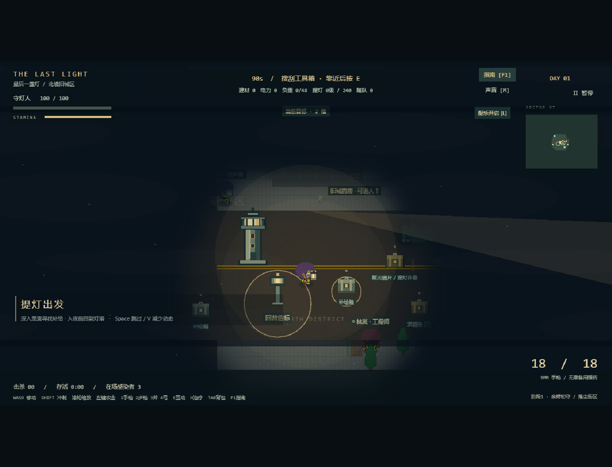
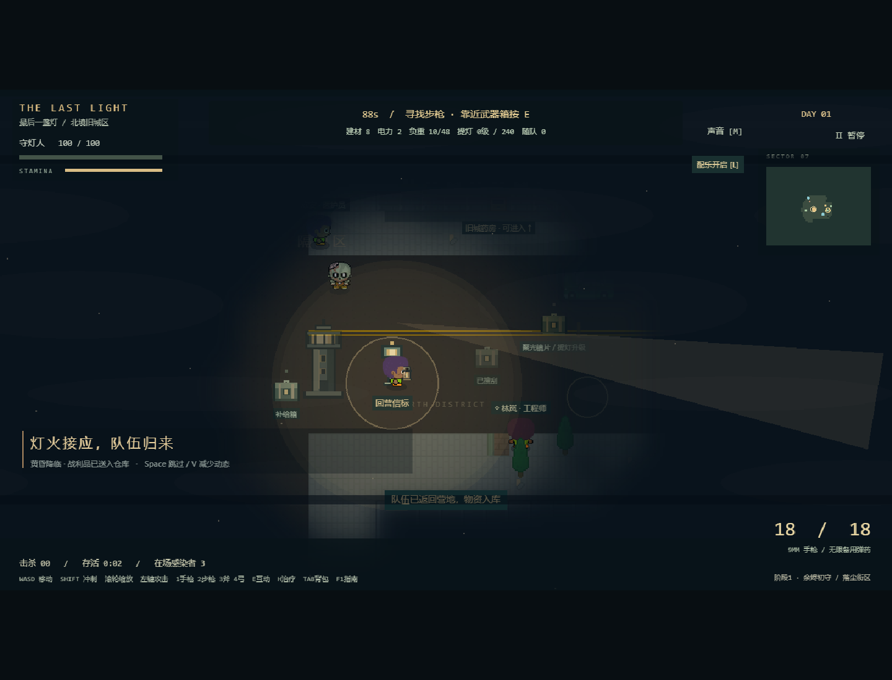
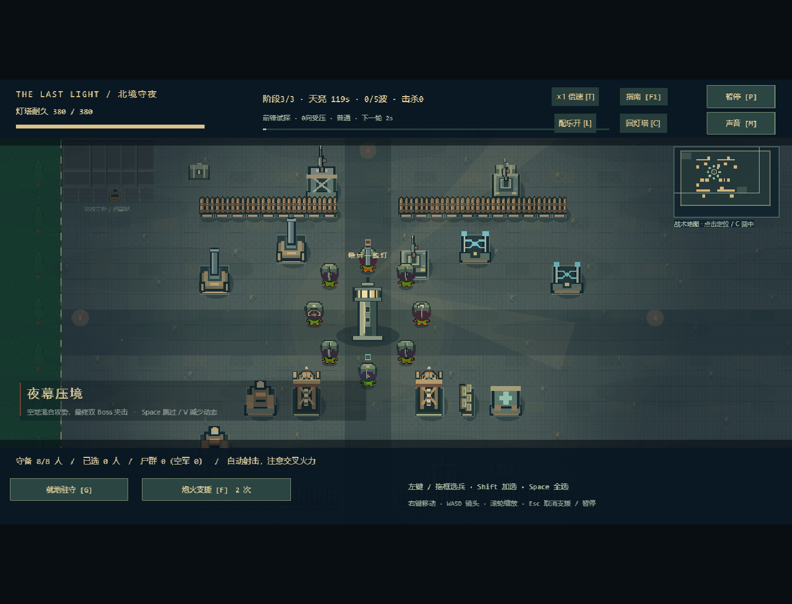
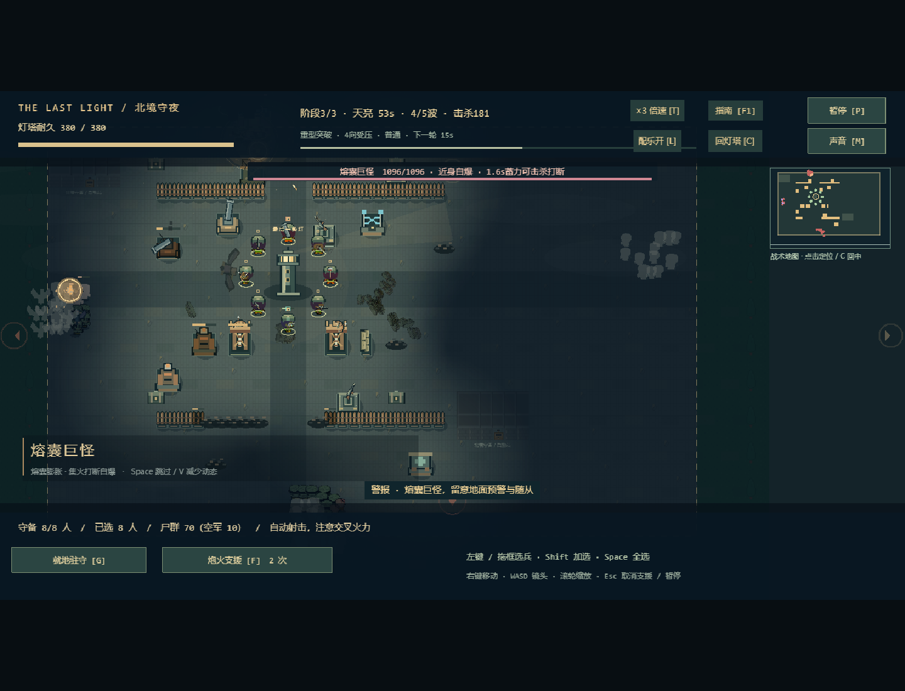
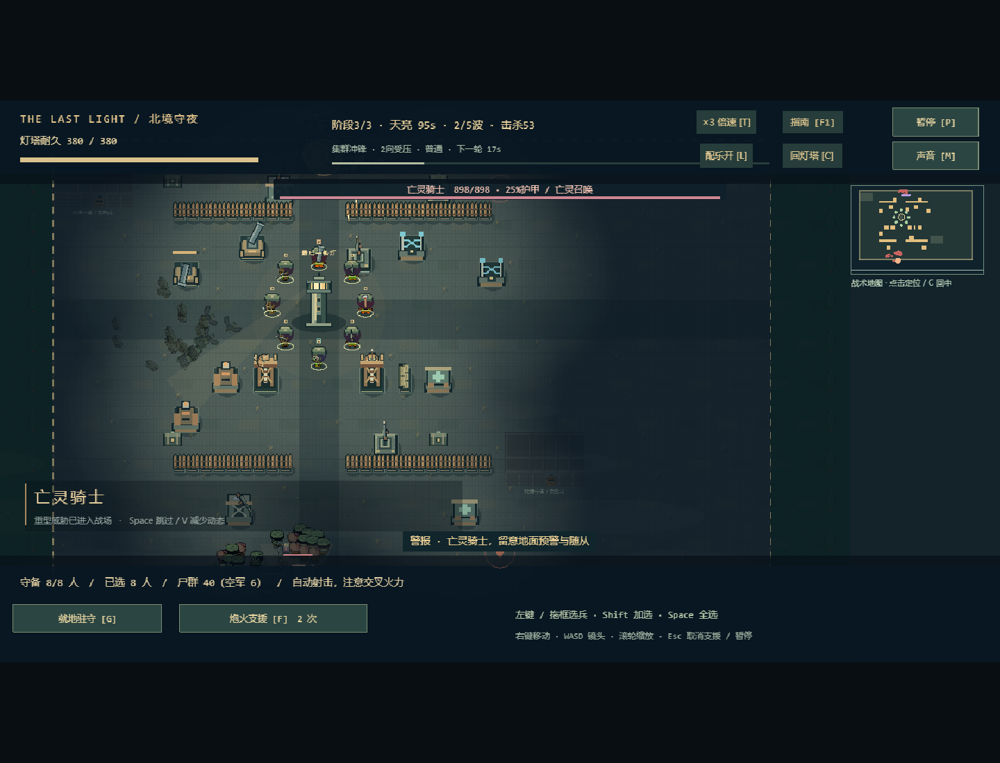
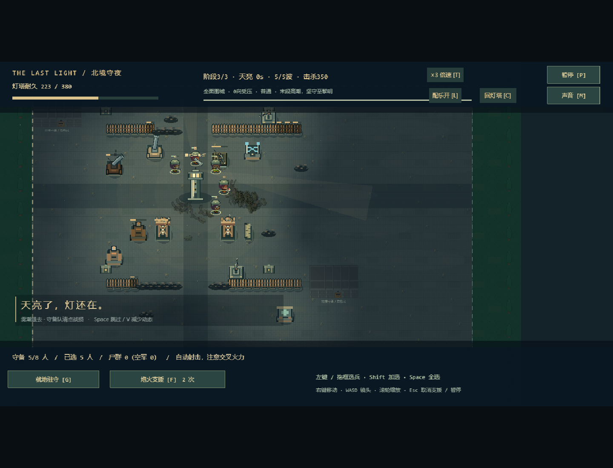
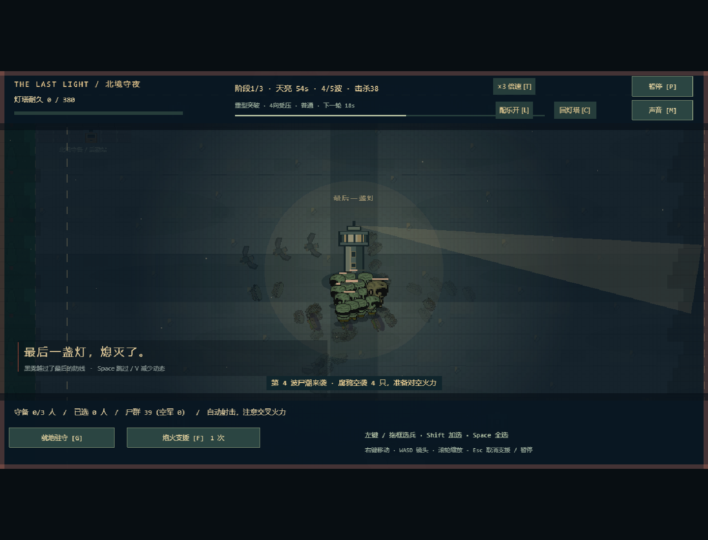
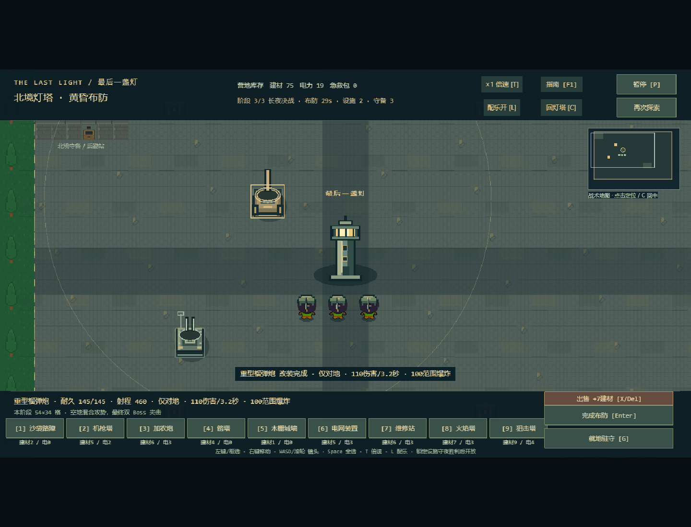
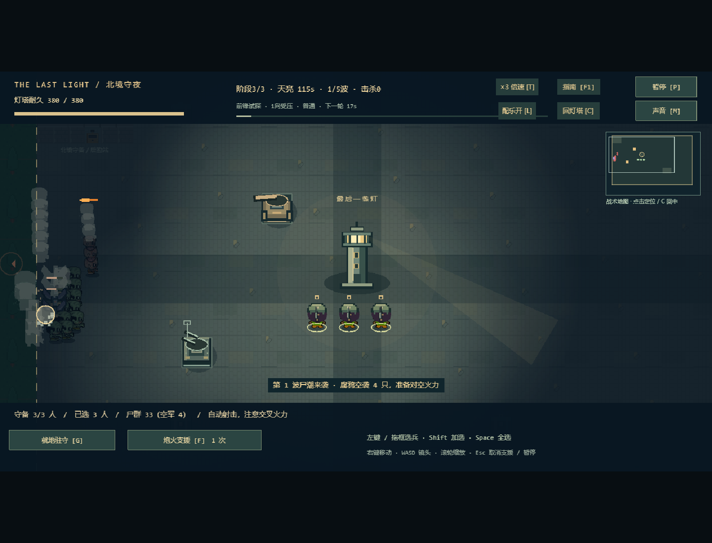
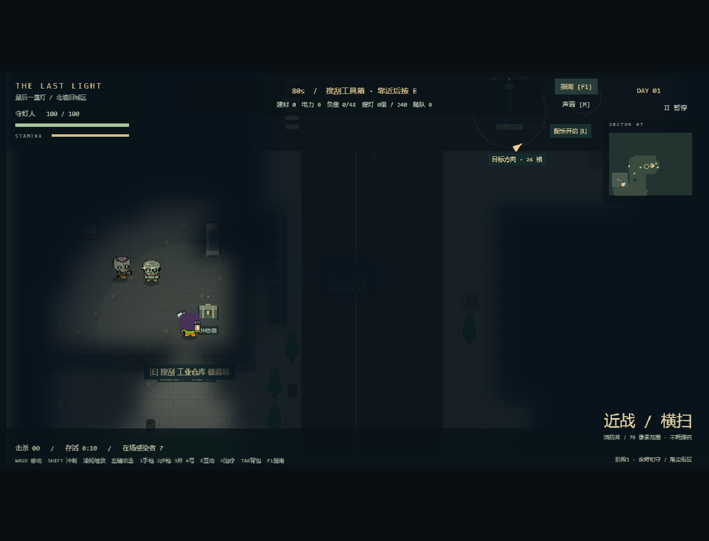
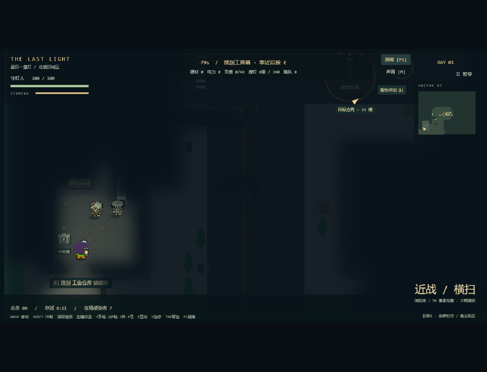
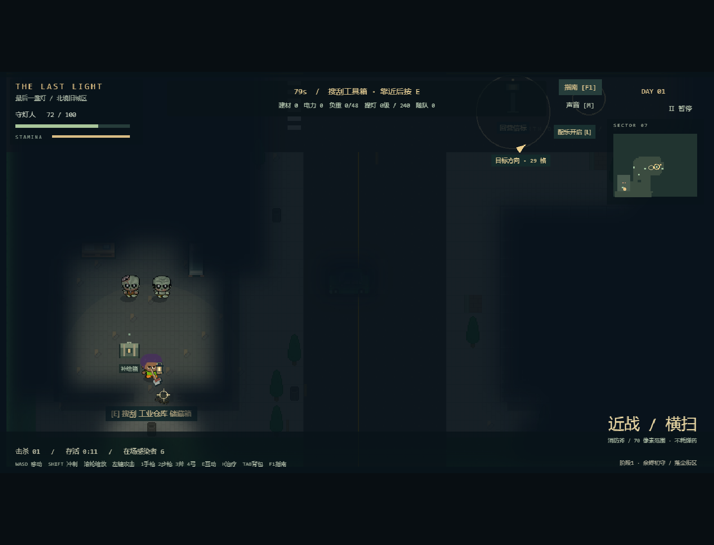

全部为实际浏览器canvas画面，保留原图，不拼接伪造敌人。录屏在 `artifacts/v011/night-real-browser.webm`（本地忽略目录，约2.8MB，无音轨）。

## 试玩路线和剩余边界

启动 `npm run dev` 或当前4173预览。第一趟：工具箱→步枪→急救补给→工程师→信标回营；建一机枪、两箭塔、一沙袋，1倍速看入夜，末段注意调兵和支援。第二阶段用范围火力覆盖西侧，给部分机枪改防空；第三阶段保留对空、把重炮手放到北侧、医师留核心，墙体给中层火力争取时间；不要将所有机枪改成仅对空。

城市复现：`?seed=1000`（货运绕行）、`?seed=1006`（隔离街垒）、`?seed=1024`（疏散通道）。向西南工业仓库走，观察建筑轮廓、门位和绕行区别；可选高危地点会提供更多资源/救援机会。既有存档通过 `?mode=base` 调整阵地，`?mode=night` 重试守夜；`difficulty=hard` 选择困难。

人工重点：1倍速听入夜低鸣与尸潮层是否适量；黄昏→夜战是否连贯；多线警报是否够清晰；末阶段能否通过微调守卫扭转危机。自动化不能判断玩家满意度。仅验收桌面Chrome；人物仍沿用现有偏大头比例的图集，没有声称重绘全套美术。城市是三套模块与有限事件，不是开放世界；中途探索没有新增断点保存。录屏无音轨，听感须实际游戏验证。

额外流派检查：将56设施夹具的火力设施全部换成机枪塔、保留外围墙与8名完整英雄，在4个侧翼种子均守住，灯塔335–380，损失11–12座设施（主要外围），没有使用支援。这个高资源/全人物样本仍表现很强，不能据此宣称单塔流已经被完全克制，也不能把它当作普通三守卫开局。[原始结果](mono-turret-v0.11.json)。下一轮平衡应优先针对这一已测到的边界；本轮没有为推翻该结果临时削弱全部射手或增加敌人生命。
