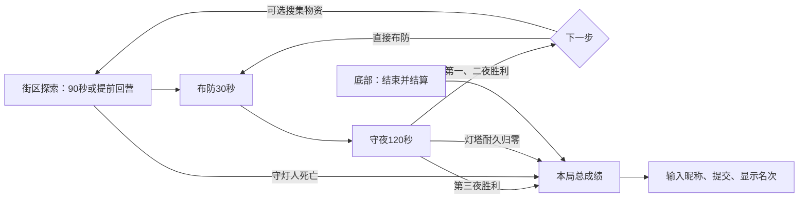

# v0.13 玩法流程与课堂演示

本轮修复灯塔画面偏左、黑色空区用途不明、失败自动重试、下一阶段必须回城、无法随时展示排行榜等问题。保留 Phaser / TypeScript 模型与 v2 营地存档坐标。

## 当前流程

前两夜胜利时 Enter 进入下一阶段布防，倒计时重新为30秒；无需返回街区。普通入口与课堂演示倒计时结束自动入夜。`?mode=base` 是既有布防练习入口，倒计时结束仍保留手动调整和 N 开战，便于练习施工。

死亡会冻结本局，结束演出后自动打开成绩与当前榜单。Enter 只能重新打开本局成绩，不会复活、重试或返回街区。主动结束先暂停，确认后冻结；取消恢复此前暂停状态。已结算的局不能继续刷分，只能开始新战役。

守夜后的阵地恢复沿用原检查点机制：设施和守卫在下次布防免费整备，库存只增加一次首胜奖励。这样玩家可以跳过探索，但仍须用有限物资布置防线；街区提供额外资源、武器和特殊人物。

## 画面、黑雾与成长

主战场使用 HUD 中间的1080×502区域，相机取消世界边缘夹紧，灯塔投影为该区域中心；C回中和滚轮缩放保持一致。右侧200像素明确用作地图、阶段与施工规则说明，底部在线入口独立占54像素，不再遮挡游戏操作。

| 当前阶段 | 灯塔照明半径（游戏坐标） | 施工范围 | 首胜补给（建材 / 电力） |
| --- | ---: | --- | --- |
| 1 | 390 | 44×26格 | 24 / 10 |
| 2 | 530 | 52×33格 | 36 / 12 |
| 3 | 690 | 58×37格 | 20 / 8 |

金色虚线内允许施工；十字通路、现有设施、士兵脚下等仍不能建。虚线外黑雾尚未开放，点击会明确说明原因且不扣资源。守夜胜利后进入下一阶段，照明、实际可见敌人、支援可选范围和可施工区域一起扩大。旧存档坐标不迁移、不丢建筑。

## 三种成绩范围

| 榜单 | 收录条件 | 极速榜 |
| --- | --- | --- |
| 正式通关 | 同一会话完成阶段1、2、3首胜 | 支持 |
| 挑战成绩 | 普通游戏死亡、主动结束或从后期存档开始的未完整战役 | 不支持 |
| 课堂演示 | `?demo=1` 或既有 `?mode=…` 练习入口 | 不支持 |

普通 / 困难继续分榜。全部结果均可提交昵称，服务端返回所选范围内的真实综合名次；完整正式通关还返回极速名次。提交前只展示得分和当前前5名，不编造个人名次。重试提交沿用同一UUID和原始载荷，避免重复计数。

评分版本为2，游戏版本为0.13.0：

- 每个已守住阶段2000分，完整三阶段再加4000分。
- 普通敌人每只5分，各阶段上限120 / 220 / 340只；Boss每只250分，上限1 / 2 / 5。
- 守住阶段按灯塔耐久比例加最多1000分、每位生还守卫100分。
- 探索击杀每只2分（最多100只）、搜刮每处25分（最多10处）、成功护送每位50分（最多8位）。失败探索不记未护送人物。
- 只有完整通关有用时效率奖励，`max(0, 3000-floor(实际活动秒数))`。未通关阶段仅累计击杀与Boss，不领取该阶段的胜利、灯塔或守卫奖励。

实际时钟排除暂停、指南、榜单、失焦与场景结算等待；倍速只改变模拟时间，不放大实际用时。浏览器成绩仍不是服务器权威防作弊，边界验证与重算用于数据一致性。

## 一分钟答辩路线

1. 点底部“课堂演示”，或打开 `/?demo=1&intro=0`。已有4座设施、基础资源和守卫，默认三倍速；普通营地不会被覆盖。
2. 可先展示滚轮缩放、C回中、建造和小地图。布防约10秒实际时间后自动入夜。
3. 夜战中点“结束并结算”，确认即可展示真实击杀分解、昵称提交、当前榜单和提交后的个人名次。
4. 如需展示成长，守住首夜后 Enter 进入第二阶段，显示扩大后的照明和施工区，30模拟秒后自动开战。

在线提交需要 API 与 PostgreSQL 已运行并配置前端 `VITE_API_BASE_URL`；静态离线模式仍可结算得分，但没有在线名次。仓库上传不等于云端后端已部署。

## 源码与迁移

相机与阶段切换：`src/scenes/BaseScene.ts`；街区死亡：`CombatScene.ts`；照明与扩建参数：`config/progression.ts`；成绩会话与公式：`core/ranking.ts`、`core/scoring.ts`；课堂初始阵地：`core/demo.ts`；提交与榜单：`view/LeaderboardPanel.ts`。

执行 `npm --prefix server run migrate` 应用 `002_run_results.sql`，增加范围、结果和探索字段，旧v1记录保留；当前v2榜单不混用旧公式记录。001迁移保持原校验和。部署、备份仍见 [后端部署指南](BACKEND_DEPLOYMENT.md)。

新增浏览器验收在 `tests/browser/run-flow.spec.ts`，覆盖居中与缩放、锁区不扣款、跳过街区及自动入夜、演示结算与真实API名次、死亡冻结。最终验收结果见 [后端验收记录](BACKEND_VALIDATION.md)。
