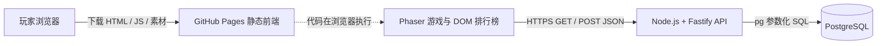

# 《最后一盏灯》后端、源码学习与答辩指南

版本：v0.12.0；开发基线：本地 `codex/story-lantern-and-fog`，提交 `ddee025`。本轮直接修改工作区，没有切回旧默认分支，也没有操作云资源。验收记录见 [BACKEND_VALIDATION.md](BACKEND_VALIDATION.md)，部署操作见 [BACKEND_DEPLOYMENT.md](BACKEND_DEPLOYMENT.md)，六天安排见 [BACKEND_STUDY_PLAN.md](BACKEND_STUDY_PLAN.md)。

## 1. 先认识这个游戏与本轮边界

审查时工作区干净，本地 v0.11 已有 Phaser 实时探索、90 秒白天、30 秒布防、120 秒夜战、三阶段成长、Boss、建造、炮塔改装、普通/困难、1–3 倍速、暂停与入夜检查点。远程 `HEAD` 查询仍指向旧的 `codex/expedition-stage-2`（`baa1804`），所以不能直接 clone 默认分支作为最新版本。

游戏不是无限生存榜。实际阶段固定为：余烬初守、雾潮围城、长夜决战。每夜持续到模拟第 120 秒且灯塔存活即胜利；同一步灯塔归零优先失败。阶段 3 胜利完成战役，但原游戏允许重试已完成阶段和继续探索。

本轮增加一个匿名双排行榜：极速榜按实际用时升序、同时间按得分降序；得分榜按分数降序、同分按实际用时升序。两者都按普通/困难隔离，默认前 20 条。完全并列时按提交时间、UUID 排序，显示稳定的顺序名次，不合并名次。同一昵称可以有多条独立战役成绩。

### 普通营地和排名战役

- 原入口继续读取 `last-light.campaign.v2`，保留原玩法和存档，不把旧富资源营地直接拿去上榜。
- 底部“排行榜”内可开始普通或困难排名战役（`?ranked=1&difficulty=normal`）。从空营地开始，阶段推进和资源规则与原游戏相同。
- 必须在同一页面会话依次完成三个阶段首胜。失败可以重试，重试操作时间累计；重复已胜阶段不追加得分。
- 排名战役的营地快照单独写 `last-light.ranked.campaign.v1`，用于本地留存；**当前不提供该快照续接排名资格，刷新/离开后重新开局**。这样避免把原有入夜前存档误当作完整计时存档。普通营地仍按原规则续玩。
- `mode=combat/base/night` 训练入口没有排名资格。修改浏览器数据仍能伪造成绩，这些机制只是减少正常使用中的误提交。
- 最终成绩、第一次提交的固定载荷和提交结果保存在 `last-light.pending-score.v1`；刷新后可从“通关成绩”重新提交。只保留最近一场结果，开始新战役前建议先处理上一场成绩。存储不可用时只能在当前页面重试。

## 2. 系统架构



Pages 只托管文件，不能运行 Node.js 或 PostgreSQL。图中的网络请求实际上由玩家浏览器发往 API。Phaser 和游戏规则不等待网络，断网时仍可正常玩。

| 运行方式 | 前端 | API | 数据库 | 连接特点 |
| --- | --- | --- | --- | --- |
| 本地 | Vite `127.0.0.1:5173` | Node `127.0.0.1:3000` | Compose 开发库 `127.0.0.1:5432` | HTTP，数据库端口只映射回环 |
| VPS | GitHub Pages | Caddy HTTPS → Docker API | 同 Compose 网络的 db | 公网只开放 SSH/80/443，不发布数据库端口 |
| 免费托管 | GitHub Pages | Render 的同一 Docker 镜像 | Neon PostgreSQL | API HTTPS，数据库连接使用验证证书的 TLS |

## 3. 最终目录与职责

`+` 为新增，`~` 为修改；未列出的大量游戏配置、素材和旧文档保留。

```text
SEAPP/
  src/
    main.ts                       游戏创建入口，沿用原场景注册
    core/
      world.ts                    角色移动、战斗、碰撞、白天敌人
      expedition.ts               探索、搜刮、营救和资源入库
      base-world.ts               建造、拆除、改装、部队命令
      night-world.ts              夜战、Boss、胜负和首胜奖励
      campaign.ts                 原 v2 营地存档的校验和读写
    + scoring.ts                  前后端共用的评分、昵称规则和接口类型
    + ranking.ts                  单调时钟、三阶段成绩累积
    scenes/
      BootScene.ts                素材加载并选择序章/游戏/训练入口
    ~ CombatScene.ts              城市输入与暂停，接入实际计时
    ~ BaseScene.ts                布防/守夜输入，接入首胜与最终结算
    ~ PrologueScene.ts            排行榜打开时也暂停序章
    services/
    + game-session.ts             排名会话与普通/排名营地存储隔离
    + leaderboard.ts              fetch、请求超时、昵称与待提交缓存
    view/
      Hud.ts / BaseHud.ts / NightHud.ts   原 Phaser HUD
    + LeaderboardPanel.ts         DOM 榜单、昵称表单、结算与暂停桥接
    ~ style.css                   在原暖金/冷雾色系上增加响应式面板
  server/
    + package.json / package-lock.json / tsconfig.json
    + src/index.ts                环境配置、启动与信号退出
    + src/app.ts                  路由、CORS、限流、统一错误
    + src/config.ts               环境变量校验
    + src/scores.ts               Zod 请求校验和业务规则
    + src/db.ts                   pg 连接池、SQL 写入与排序查询
    + src/migrate.ts              带事务、锁和校验和的 SQL 迁移
    + sql/001_scores.sql          成绩表、约束、两个复合索引
    + sql/seed.sql                仅手动导入的两条演示记录
    + scripts/copy-sql.mjs        把 SQL 随后端构建复制到 dist
    + tests/fixtures.ts           测试成绩夹具
    + tests/api.test.ts           API 校验、失败、CORS、限流测试
    + tests/database.integration.ts   真实 PostgreSQL 集成测试
    + Dockerfile                  构建与运行分离，非 root 运行
    + .env.example / .env.test.example
  tests/
    + ranking.test.ts             计时、首胜、计分、昵称测试
    + browser/leaderboard.spec.ts  表单、断网、布局、真实 API 浏览器联调
    ~ browser/bosses.spec.ts       实际视野定位与跨帧按下，保留原建筑/战斗断言
    ~ browser/base.spec.ts         全选按键处理完成后再验证右键行军
    其他原游戏测试                 持续回归角色、战斗、建造、存档等
  scripts/
    ~ simulate-progression.mjs    原三阶段模拟增加实际结算→评分验证
    + test-with-local-postgres.mjs   无 Docker 时的可选临时数据库验收
    + verify-pages.mjs            无 API 的 Pages 子路径生产验证
  + compose.yaml                  API + 持久化 PostgreSQL，共用基础
  + compose.dev.yaml              本地回环端口映射
  + compose.prod.yaml             VPS Caddy HTTPS，无数据库公网端口
  + deploy/Caddyfile / deploy/.env.production.example
  + render.yaml                   Render Free Docker 部署描述
  ~ .github/workflows/ci.yml      增加后端、真实数据库与镜像构建检查
  ~ .github/workflows/deploy.yml  仍只上传 dist，增加公开 API 地址变量
  + docs/BACKEND_GUIDE.md         本文
  + docs/BACKEND_DEPLOYMENT.md    VPS、Render/Neon、备份、恢复
  + docs/BACKEND_STUDY_PLAN.md    六天学习与亲自验收
  + docs/BACKEND_VALIDATION.md    实际测试结果及未验证事项
```

前后端使用两份 package-lock，根目录构建只处理前端。后端为了复用 `src/core/scoring.ts`，编译结果在 `server/dist/server/src/`，共用模块在 `server/dist/src/core/`；这是 tsc 的目录输出，不是额外的一套服务。

## 4. 功能—源码对应表

以下名称按最终源码核对，不依赖容易漂移的行号。编辑器用 Ctrl+P 找文件，Ctrl+F 找函数。

| 演示功能 | 源码路径 | 核心类/函数 | 调用关系 |
| --- | --- | --- | --- |
| 游戏启动 | `src/main.ts`、`src/scenes/BootScene.ts` | `new Phaser.Game`、`BootScene.preload/create` | 注册场景 → 加载素材 → 序章或 Combat/Base |
| 角色控制 | `src/scenes/CombatScene.ts`、`src/core/world.ts` | `inputState`、`update`、`CombatWorld.step` | 键鼠 → 输入状态 → 固定步长更新位置 |
| 战斗 | `src/core/world.ts`、`src/core/night-world.ts` | `CombatWorld.step/damageZombie`、`NightWorld.step/damageEnemy` | 子弹碰撞 → 伤害 → 一次死亡事件 |
| 敌人生成 | `src/core/world.ts`、`src/core/expedition.ts`、`src/core/assault.ts` | `spawnZombie`、`ExpeditionWorld.step`、`assaultPlan` | 白天按间隔生成；夜战队列由 `NightWorld.step` 出兵 |
| 建造与防御 | `src/core/base-world.ts` | `preview/build/buildWalls/demolish/refit` | BaseScene 按键点击 → 合法位置/资金检查 → 扣资源 |
| 指挥守卫 | `src/core/base-world.ts` | `move/hold/stepSoldiers` | 选兵/右键 → 路径 → 行军或驻守 |
| 资源结算 | `src/core/expedition.ts` | `interact`、私有 `finish` | 回营或黄昏 → 入库、营救、提灯升级 |
| 阶段通关判定 | `src/core/night-world.ts` | `step`、私有 `end`、`resultCampaign` | 先检查灯塔归零，再检查 120 秒；首胜推进 `clearedStage` |
| 完整战役判定 | `src/core/ranking.ts`、`src/scenes/BaseScene.ts` | `RankedRun.finishNight`、`BaseScene.persist` | 每次夜战结算 → 按 1/2/3 顺序记录首胜 → 最终结果 |
| 通关时间 | `src/core/ranking.ts`、`src/services/game-session.ts` | `ActivePlayClock.update/read`、`updateRun` | Scene 活动/暂停/退出事件 → `performance.now()` 差值 |
| 综合分数 | `src/core/scoring.ts` | `calculateScore`、`SCORE_RULES` | 前端展示 + 后端 `submissionSchema` 重算同一个函数 |
| 本地存档 | `src/core/campaign.ts`、`src/services/game-session.ts` | `decodeCampaign/loadCampaign/saveCampaign`、`loadGameCampaign/saveGameCampaign` | 普通营地沿用 v2；排名另存快照 |
| 昵称输入 | `src/view/LeaderboardPanel.ts`、`src/core/scoring.ts` | `renderResult`、`normalizeNickname/validNickname` | DOM input → NFKC 归一化 → 本地保存与提交 |
| 提交排行榜 | `src/services/leaderboard.ts`、`server/src/app.ts` | `submitScore`、`buildApp` 中 POST 路由 | fetch → POST JSON → `submissionSchema.parse` |
| 查询排行榜 | `src/view/LeaderboardPanel.ts`、`src/services/leaderboard.ts` | `render`、`getLeaderboard` | 选榜/难度 → GET → 安全文本表格 |
| 数据库写入 | `server/src/db.ts` | `createStore().submit` | 参数化 INSERT → 冲突时读取比较原内容 |
| 数据库读取 | `server/src/db.ts` | `createStore().leaderboard` | 难度+版本 WHERE → 固定枚举 ORDER BY → LIMIT |
| 在线界面暂停 | `src/view/LeaderboardPanel.ts` | `bindOnlinePanel` | 打开事件记住暂停状态 → 关闭恢复；失焦继续保持暂停 |
| 数据库初始化 | `server/src/migrate.ts` | `migrate` | 事务+咨询锁 → 检查迁移校验和 → 执行 SQL |

建议先学 10 个文件：`main.ts` → `CombatScene.ts` → `BaseScene.ts` → `ranking.ts` → `scoring.ts` → `LeaderboardPanel.ts` → `services/leaderboard.ts` → `server/src/app.ts` → `server/src/db.ts` → `server/sql/001_scores.sql`。看不懂类型声明时，先跟着输入、函数调用和返回值走，不必逐行背诵。

## 5. 实际时间和评分怎样计算

### 计时事件

开始于排名战役第一次进入城市探索场景。`CombatScene.create/update` 让时钟运行；探索完成或死亡、场景退出时停止。布防和夜战通过 `BaseScene.create/update` 继续同一个时钟；切换场景和结算等待时停止。第三阶段首胜的 `persist → finishNight` 固定最终时间。

P/Esc、背包、F1 指南、排行榜、失焦和隐藏页面都会停止活动时间；恢复从新时间点继续，不补算后台停留。序章、载入等待和最终结算阅读不计入。实际战斗仍运行的 Boss/出发镜头计入，结算后的黎明演出不计入。

时钟用 `performance.now()` 的毫秒差值，不用可能跳变的系统日期，也不用 Phaser 被限幅的 `delta`。游戏中的 `elapsed` 是模拟秒，三倍速时推进更快，因此不能拿 `NightWorld.elapsed` 当实际通关时间。倍速只影响实际完成速度，成绩记录本场最高使用倍速；默认两个榜均允许原有 1–3 倍速，界面明确显示。暂停本身不扣分，玩家可暂停思考，这是一条公开规则。

失败重试保留已经消耗的活动时间，不清零。继续原阶段不会重复记分；进入新排名战役则新建 UUID 和空时钟。单场实际活动时间超过 24 小时、或数据异常时不生成在线成绩，游戏仍可结算。

### 评分公式（版本 1）

只使用三个阶段首胜的夜战摘要，不新增游戏机制。设 `K` 为该阶段总击杀（含 Boss），`B` 为 Boss 击杀，`H` 为灯塔耐久，`S` 为生还守卫：

| 项目 | 规则 | 说明 |
| --- | --- | --- |
| 完整通关 | 10,000 | 三阶段全部胜利才有 |
| 普通击杀 | 每阶段 `min(K-B, 上限) × 5`，上限依次 120/220/340 | Boss 从普通击杀中扣除；召唤物也受本阶段总上限约束 |
| Boss | 每个 250，阶段上限 1/2/5 | 不要求击杀所有 Boss，沿用存活到黎明即胜利的玩法 |
| 灯塔 | 每阶段 `floor(H × 1000 / 380)` | 合计最多 3,000 |
| 守卫 | 每阶段 `S × 100` | 每阶段最多 8 人，合计最多 2,400 |
| 效率 | `max(0, 3000 - floor(活动毫秒 / 1000))` | 超过 50 分钟为 0，不出现负分 |

击杀由原 `damageEnemy` 对已经死亡的敌人提前返回，只触发一次；最终只取三次首胜数据，不能通过重试累计。白天击杀、重复探索箱子、无限积累库存不直接加分。探索更多资源可以改善防御，但需要更多活动时间，保留取舍。

三夜模拟时间合计 360 秒，最高三倍速时真实时间下界为 120 秒；后端根据 `maxSpeed` 再校验相应下界。API 允许分数范围 10,000–23,800，并要求精确匹配公式；按最短时间算可达到的公式上界为 23,680。这个边界检查不能证明玩家真的玩过。

例：三个阶段击杀 50/100/150，Boss 都是 1，灯塔都是 300，守卫都是 3，活动时间 480,000ms，得到：`10000+1485+750+2367+900+2520=18022`。前端和数据库演示种子使用同一算法。

## 6. 一次成绩提交的完整流程

1. `NightWorld.step → end` 判定第三阶段胜利，生成夜战摘要。
2. `BaseScene.persist` 把摘要交给 `RankedRun.finishNight`。后者固定活动时间，调用 `calculateScore`，生成含 `runId`、版本、难度和三阶段摘要的结果。
3. `onlinePanel.remember` 保存待提交结果。黎明演出结束后 `open('result') → renderResult` 展示构成和昵称输入。
4. 玩家输入“北境守灯人”，前端先用 `normalizeNickname/validNickname` 校验。昵称是公开标签，允许重名，没有账号或设备身份。
5. 表单第一次发送前固定载荷并保存到本地；点击后显示“正在提交”，按钮禁用。`submitScore → request` 用 `fetch` 发 POST JSON，12 秒超时。
6. Fastify 的 `buildApp` 应用 CORS、8KiB 请求体上限和每 IP 每分钟 5 次写入限流，然后 `submissionSchema.parse` 校验字段、胜利、三阶段顺序、时间下界和分数。
7. `createStore().submit` 执行 `INSERT ... VALUES ($1,...) ON CONFLICT(id) DO NOTHING`。UUID 同时是记录 ID 和战役幂等键，不需额外身份表。
8. PostgreSQL 原子保存，首次返回 201；同 UUID、同内容重放返回 200；同 UUID 不同内容返回 409。即使第一条响应在网络上丢失，重试也不会新增一条成绩。
9. 前端显示已收录。“查看排行榜”调用 GET，后端按对应排序读取，再通过 DOM `textContent` 填表，不把昵称作为 HTML 插入。

第一次发出后昵称暂时锁定，因为超时并不能证明服务器没写入；此时修改载荷会产生 409。下一场战役仍可改昵称。同名玩家不覆盖彼此。失败不影响本地战役结果，后端不可用不阻塞 Phaser 循环。

## 7. 接口、数据库和安全边界

| 接口 | 参数 | 成功结果 |
| --- | --- | --- |
| GET `/api/health` | 无 | 200 `{status:"ok",database:"ready",scoreVersion:1}`；真实查询成绩表，不只检查进程 |
| GET `/api/leaderboard` | `board=speed/score`、`difficulty=normal/hard`、`limit=1..20` | 200 `{board,difficulty,scoreVersion,entries:[...]}` |
| POST `/api/scores` | 下方 JSON | 201 或幂等重放 200，`{entry,duplicate}` |

其他状态：400 输入错误；403 不允许的 Origin；404 路由不存在；409 战役载荷冲突；413 请求体过大；415 非支持的媒体类型；429 限流并带 Retry-After；503 数据库/服务暂不可用。错误结构是 `{error:{code,message,fields?}}`，不返回 SQL、连接串或密码。

仅在开发/测试库中使用的完整请求示例：

```json
{
  "runId": "10000000-0000-4000-8000-000000000001",
  "nickname": "示例守灯人",
  "difficulty": "normal",
  "completed": true,
  "durationMs": 480000,
  "score": 18022,
  "maxSpeed": 3,
  "scoreVersion": 1,
  "gameVersion": "0.12.0",
  "stages": [
    {"stage":1,"kills":50,"bossKills":1,"lampHealth":300,"soldiers":3},
    {"stage":2,"kills":100,"bossKills":1,"lampHealth":300,"soldiers":3},
    {"stage":3,"kills":150,"bossKills":1,"lampHealth":300,"soldiers":3}
  ]
}
```

`scores` 只有一张业务表。列有 UUID 主键、昵称、难度、实际毫秒、总分、最高倍速、评分版本、游戏版本、三阶段 JSONB 摘要、带时区的提交时间。`schema_migrations` 是迁移管理表，不是额外业务实体。两个复合索引分别匹配两种榜单的筛选和排序。

昵称先 NFKC 归一化、去首尾空格，允许 2–16 个字母/汉字、数字、单空格、`_ - ·`，拒绝控制符、HTML 和双空格。SQL 参数与语句分开，排序片段只从后端的两个常量选择。数据库的 CHECK 再兜底范围和结构，但精确评分和昵称字符规则主要在 API 层；管理员绕过 API 直接改表也会绕过部分业务校验。

全局限流 120 次/IP/分钟，写入 5 次/IP/分钟，健康检查不计入。限流在单进程内存中，重启会清零；学校共享 IP 可能共用限额。默认不相信 `X-Forwarded-For`，VPS/Render 只信任最近一跳代理，并且 API 不直接暴露公网。不要在 API 直连公网时随意开启 TRUST_PROXY。

连接池最多 5 条连接，建立连接 3 秒超时，数据库语句 5 秒上限，客户端查询 6 秒上限，HTTP 请求/连接有 10 秒限制。数据库不可用返回 503。生产 TLS 使用证书验证，不采用 `rejectUnauthorized:false`；连接串要求 TLS 时不能配置为 disable。

**本版本没有服务器权威防作弊。** 玩家能修改 JS、localStorage 或自己构造 HTTP 请求；服务器只能确认字段、范围与数学关系一致。UUID 解决意外重复，不证明身份，也无法阻止换 UUID 重新提交。CORS 是浏览器访问规则，不能阻止命令行伪造请求。该系统适合课程展示和朋友交流，不适合作为有奖竞技依据。

## 8. 从零本地运行（Windows PowerShell）

安装 Node.js 24+、Git。Docker Desktop/WSL2 的安装见部署文档；未安装 Docker 时可使用已有 PostgreSQL 或可选临时测试方案。下面所有示例密码仅限本地。

### A. 安装依赖和准备环境变量

```powershell
cd D:\Projects\SEAPP
npm ci
npm ci --prefix server
Copy-Item .env.example .env
Copy-Item server/.env.example server/.env
```

首次才复制，已有 `.env` 时先检查内容，不要覆盖自己的配置。根 `.env` 给 Vite/Compose，`server/.env` 给 Node；不要把数据库密码写到 `VITE_` 变量，它会公开出现在浏览器产物中。

### B. 启动数据库

```powershell
docker compose -f compose.yaml -f compose.dev.yaml up -d db
docker compose -f compose.yaml -f compose.dev.yaml ps
npm --prefix server run migrate
# 可选：只在开发库导入两条演示记录
npm --prefix server run seed
```

基础 Compose 的 db 不开放主机端口，`compose.dev.yaml` 才映射到本机 127.0.0.1:5432。数据在 Docker Volume 中，停止/重启容器后仍保留。修改 POSTGRES_PASSWORD 环境变量不会自动修改已经初始化的数据库用户密码；旧 Volume 应通过 SQL 修改密码，不要盲目删卷。

### C. 分别启动 API 与前端（两个终端）

```powershell
# 终端一：根目录
npm run server:dev
```

```powershell
# 终端二：根目录
npm run dev
```

打开 `http://127.0.0.1:5173/`，点击底部排行榜；从榜单入口开始新排名战役。直接使用完整 Compose 运行后端也可以：

```powershell
docker compose -f compose.yaml -f compose.dev.yaml up -d --build
npm run dev
```

两种 API 启动方式选一种，否则 3000 端口会冲突。容器入口自动跑版本化迁移，不导入演示数据。

### D. 查看接口、执行 SQL、日志和停止

```powershell
Invoke-RestMethod http://127.0.0.1:3000/api/health
Invoke-RestMethod 'http://127.0.0.1:3000/api/leaderboard?board=speed&difficulty=normal'
docker compose -f compose.yaml -f compose.dev.yaml exec db psql -U seapp -d seapp_dev
# 在 psql 内输入 SELECT count(*) FROM scores;，输入 \q 退出
docker compose -f compose.yaml -f compose.dev.yaml logs --tail=100 api db
docker compose -f compose.yaml -f compose.dev.yaml stop
```

终端运行的 Vite/API 用 Ctrl+C 停止。`stop` 保留容器和 Volume；`down` 也保留命名 Volume。**不要加 `-v`，那会删除数据库卷。** 在浏览器 F12 → Network 中点击榜单，能看到 GET/JSON；提交示例只在测试库中执行。

### E. 测试库与无 Docker 验收

开发、测试、生产分别使用 `seapp_dev`、`seapp_test`、`seapp_prod` 和独立环境变量。测试只允许名称包含 `_test` 或 `test_` 的库，并会清空该库的 scores 表；不要把正式库改个名字就拿来测。

```powershell
docker compose -f compose.yaml -f compose.dev.yaml exec db createdb -U seapp seapp_test
Copy-Item server/.env.test.example server/.env.test
npm --prefix server run test:integration
```

本轮机器没有 Docker，真实数据库验收使用了 PostgreSQL 17 临时二进制。可复现方式（只用于测试，不代替学习 Compose）：

```powershell
npm install --prefix artifacts/pg-runtime --no-save --package-lock=false embedded-postgres@17.10.0-beta.17
node --experimental-strip-types scripts/test-with-local-postgres.mjs
# 再做真实浏览器/API联调，或完整浏览器回归
node --experimental-strip-types scripts/test-with-local-postgres.mjs --e2e
node --experimental-strip-types scripts/test-with-local-postgres.mjs --e2e --all
```

工具只绑定回环、随机端口/密码，退出时停止数据库，数据留在已忽略的 artifacts 目录。`--e2e` 临时占用 3000/4173，并构建含 localhost API 地址的本地验收产物；发布前必须用正式 API 地址重新构建，不能把这份 dist 上传线上。普通 `npm run build` 在未配置生产 API 时仍能生成可离线运行的静态游戏。

## 9. DBeaver 操作教程

1. 安装 DBeaver Community，New Database Connection → PostgreSQL。开发连接填写 Host `127.0.0.1`、Port `5432`、Database `seapp_dev`、User `seapp`，密码用本地 `.env` 中的值；首次按提示下载 JDBC 驱动。测试连接另建，数据库填 `seapp_test`，明显标记“测试可清空”。
2. Test Connection 成功后展开 Databases → Schemas → public → Tables → scores，右键 View Data → All Rows。看 `id`、`nickname`、`duration_ms`、`score`、`submitted_at` 和 `stages`。
3. 右键连接 → SQL Editor → New SQL Script，执行查询：

```sql
SELECT id, nickname, difficulty, duration_ms, score, submitted_at
FROM scores WHERE nickname = '示例守灯人';

-- 极速通关榜
SELECT nickname, duration_ms, score FROM scores
WHERE difficulty='normal' AND score_version=1
ORDER BY duration_ms ASC, score DESC, submitted_at ASC, id ASC LIMIT 20;

-- 综合得分榜
SELECT nickname, score, duration_ms FROM scores
WHERE difficulty='normal' AND score_version=1
ORDER BY score DESC, duration_ms ASC, submitted_at ASC, id ASC LIMIT 20;
```

4. 导入测试记录：只连接开发/测试库，在 SQL Editor 打开 `server/sql/seed.sql`，全选执行。两条固定 UUID 的记录可重复执行，不会重复插入。正式迁移不会自动加这些记录。
5. 修改/删除练习只针对演示 UUID，先 SELECT 核对，再在手动事务中操作：

```sql
BEGIN;
UPDATE scores SET nickname='示例改名'
WHERE id='00000000-0000-4000-8000-000000000001';
SELECT * FROM scores WHERE id='00000000-0000-4000-8000-000000000001';
ROLLBACK; -- 第一次先回滚，确认理解后才使用 COMMIT

BEGIN;
DELETE FROM scores WHERE id='00000000-0000-4000-8000-000000000002';
ROLLBACK;
```

不要为了演示直接改真实玩家分数，直接 SQL 修改会绕过 API 公式校验。DBeaver 表格改动也要检查待执行 SQL 和影响行数。

6. 备份：右键开发数据库 → Tools → Backup，格式 Custom，配置 PostgreSQL 客户端目录（需包含 pg_dump）。恢复用新建的空测试库 → Tools → Restore，选择该 dump；核对行数和两种排序。仅导出 CSV 不是完整数据库备份，缺少约束和迁移记录。等效 CLI 和 Windows 二进制文件注意事项见部署文档。[DBeaver 官方备份恢复说明](https://dbeaver.com/docs/dbeaver/Backup-Restore/)
7. VPS 连接使用 SSH 隧道，不公开 5432。数据库未映射主机端口时，按部署文档查询容器内网 IP，在 DBeaver 的 Main 中填该 IP/5432，SSH 中填 VPS 地址和自己的登录方式；私钥只留本机。Neon 则用平台连接参数和验证证书的 SSL 设置。[DBeaver SSH 配置说明](https://dbeaver.com/docs/dbeaver/SSH-Configuration/)

## 10. 技术栈，用自己的话解释

| 技术 | 用途和选择理由 |
| --- | --- |
| TypeScript | JavaScript 加上类型检查，能提前发现把字符串当数字等问题。前后端都用它，也能共用评分函数；浏览器和 Node 最后执行的是 JavaScript。 |
| Phaser | 管理画布、场景、素材、动画、输入和镜头。项目已有成熟游戏代码，所以保留引擎，仅增加联网界面。 |
| Vite | 本地开发服务器和前端打包工具。把源码与本地素材打成 dist，适合 GitHub Pages 静态托管。 |
| Node.js | 在浏览器外运行 JavaScript 的运行时。服务进程长期监听端口，接收玩家 HTTP 请求。 |
| Fastify | 帮 Node 声明路由、处理 JSON、日志和插件。代码少、类型支持好，适合这三个接口；不再加复杂控制器框架。 |
| REST API | 通过 URL、HTTP 方法、状态码和 JSON 约定前后端通信。GET 查询榜单，POST 新增成绩，前后端不必放在同一服务器。 |
| PostgreSQL | 真正持久保存排行榜的关系数据库。唯一约束能处理并发重复写入，索引和 ORDER BY 能稳定查询前 20 名。 |
| SQL / pg | SQL 描述建表、插入和查询，pg 把 Node 连接到 PostgreSQL。直接写参数化 SQL，便于课堂解释，没有引入 ORM。 |
| Zod | 在运行时检查不可信 JSON 的字段与取值。TypeScript 类型不会自动保护 HTTP 接口，所以仍需要运行时校验。 |
| Docker | 把 Node 或 PostgreSQL 及其运行环境装进容器。环境更容易复现，数据库文件通过 Volume 保留。 |
| Docker Compose | 用一个 YAML 描述 API、数据库和代理怎样一起启动。开发和生产复用基础配置，只有端口和 Caddy 不同。 |
| Linux | VPS 常用操作系统，负责进程、文件权限、网络和日志。课程学习重点是能登录、查看服务、定位问题，不要求背所有命令。 |
| SSH | 加密登录远程 Linux 的协议，也可建立数据库隧道。私钥保存在自己的电脑，不写进仓库或聊天。 |
| Caddy | 反向代理，把 HTTPS 请求转发给内部 API。通过域名自动管理证书，减少手动配置 TLS 的工作。 |
| GitHub Actions | 仓库中的自动化流程，安装依赖、构建和运行测试。配置已加入真实 PostgreSQL 服务测试，但本轮没有触发远端运行。 |
| GitHub Pages | 发布 dist 内的静态游戏文件。它不执行后端，前端通过公开的 API 地址访问独立服务。 |
| Render / Neon | Render 托管同一 Node Docker 后端，Neon 托管 PostgreSQL。迁移主要是更换数据库连接和前端 API 地址，不重写业务代码。 |

## 11. 老师可能问的 20 个问题

1. **程序是什么架构？** 浏览器运行 Phaser 游戏，单独的 Fastify 后端提供 JSON API，PostgreSQL 存成绩。前后端通过 HTTP 分离，断网仍能玩单机。
2. **为什么不直接用 Pages 存排行榜？** Pages 只发静态文件，没有可长期写入的数据库服务。浏览器本地存档也只属于当前电脑，不能成为大家共享的榜单。
3. **怎样定位角色移动代码？** CombatScene 的 inputState 读取键鼠，把方向交给 CombatWorld.step，后者处理移动与碰撞；画面再读取模型位置。
4. **哪里判断胜负？** NightWorld.step 先检查灯塔是否归零，再检查是否到 120 秒。RankedRun.finishNight 另外要求依次获得三个阶段首胜，才算完整上榜战役。
5. **为什么不用生存天数排名？** 这个版本固定三个阶段，完成的人天数相同。改用实际用时和综合分数更有区分度。
6. **暂停时计时怎么办？** 场景暂停会调用 updateRun(false)，活动时钟停止；恢复从 performance.now 的新时间点继续。不会把背包、指南、失焦或结算等待算进去。
7. **为什么又加了一个计时器？** 原 elapsed 是受倍速影响的模拟秒。排行榜要记录实际活动时间，所以独立使用单调时钟，两者用途不同。
8. **分数怎么算，能无限刷吗？** 完整通关奖励加三次首胜的击杀、Boss、灯塔、守卫和效率。击杀有每阶段上限，重试同阶段不重复记分，但会继续消耗活动时间。
9. **成绩怎样到数据库？** submitScore 用 fetch 发 JSON，app.ts 的 POST 路由校验，再由 db.ts 通过 pg 执行带占位符的 INSERT。
10. **为什么不要求注册？** 本期只做简单排行榜，昵称是公开显示名称，不是可靠身份。同名可以共存，也没有找回账号功能。
11. **超时后再点会写两条吗？** 同一战役重用同一 UUID，数据库主键只允许一条。同内容重放返回成功，修改内容则返回 409。
12. **怎样防 SQL 注入？** 用户数据用 $1 等占位符交给 pg，不能拼进 SQL。排序只能在两个后端常量之间选择。
13. **昵称带 HTML 会怎样？** API 的字符规则会拒绝；前端也使用 textContent。即使接口异常返回恶意字符串，浏览器把它显示为文本。
14. **有没有严格防作弊？** 没有。后端验证数学关系与范围，但客户端事件和时间仍能伪造；UUID、CORS 和限流都不能证明玩家真实通关。
15. **为什么有两个索引？** 两个榜的主排序字段不同，各自的复合索引包含难度、评分版本和排序字段。这样查询前 20 条更合适，代价是写入时维护两个索引。
16. **数据库坏了游戏还能玩吗？** 可以，网络逻辑不在游戏模拟循环里。API 返回 503，前端保留结果并提示重试，普通操作继续运行。
17. **测试了哪些层？** 纯函数测试计时和评分，API 测试校验与失败，真实 PostgreSQL 测试保存和排序，Chrome 测试界面与实际 fetch；原游戏规则和浏览器案例继续回归。具体数量按验收文档回答。
18. **Docker 和 Compose 有什么区别？** Docker 运行单个容器，Compose 把 API、数据库和 Caddy 的配置放在一起。数据库卷独立于容器，停止容器不等于删除数据。
19. **怎样从 VPS 搬到免费平台？** 先备份并恢复到 Neon，核对数据和两种排序，再让 Render 使用同一个后端镜像，更新 Pages 的 API 地址并验证。全部确认并保留可用备份后，才由我决定是否停用 VPS。
20. **AI 做了什么，你做了什么？** 本轮代码、SQL、测试和文档由 Codex 按我的需求生成并在本机执行验收。技术栈和学习目标由我提出；我接下来会亲自启动、查 SQL、部署和解释调用链。没有完成的学习或云部署不能说成我已独立做过。

## 12. AI 辅助开发与真实验证

本轮由 Codex 完成代码审查、实现、测试脚本、SQL 和学习文档；用户明确选择 TypeScript/Node/Fastify/PostgreSQL/pg/Docker、双榜与不做复杂社交的范围。三阶段首胜、独立排名入口、活动时钟、评分上限和 UUID 幂等属于 Codex 根据实际代码作出的实现选择，用户应在学习后理解并评价这些选择。

自动化运行结果和限制记录在 [BACKEND_VALIDATION.md](BACKEND_VALIDATION.md)。测试夹具中的富资源营地、虚拟时钟、预置待提交结果仅用于测试对应模块，不能称作学生真实手玩成绩或服务器防作弊证明。尚未完成的 Docker 启动、VPS/Render/Neon 部署和学生亲自验收，明确保留为后续操作。
