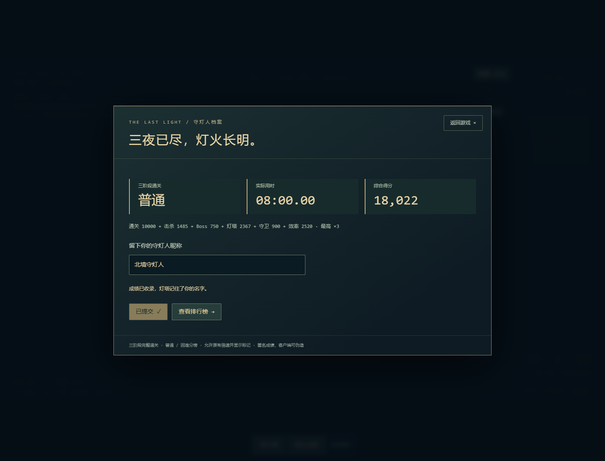
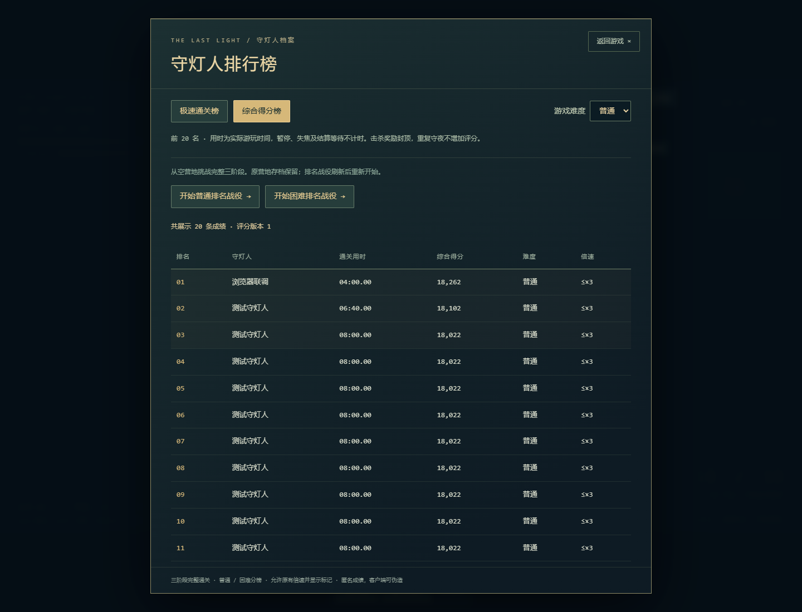

# v0.14 / v0.13 / v0.12 实现与验收记录

## v0.14 增量验收（2026-10-27）

基于`534b60c`，移除课堂演示，新增主菜单、五阶段、简单/普通/困难、阶段检查点重开与继续、全幅灯塔图像居中。用时改为探索＋布防＋守夜的游戏进度，另保留实际活动用时；综合得分仍独立排行。当前设计见 [v0.14说明](21-v0.14-game.md)。

| 验收 | 已确认结果 |
| --- | --- |
| 游戏规则 `npm test` | 103/103通过，含五阶段、三难度、入口保留、相位计时、重开检查点 |
| 旧版 `npm run test:legacy` | 22/22通过 |
| API `npm --prefix server test` | 9/9通过；总用时相位合计、三难度、移除新演示成绩均验证 |
| 前后端生产编译 | 通过；Vite仍提示Phaser包较大，SQL随后端复制通过 |
| PostgreSQL17 | 10/10（9子场景+父测试）通过：迁移003、五阶段数据、相位完整性、真实名次、幂等、旧版隔离、时间/分数排序 |
| 真实API与全部浏览器 | 首批52项中51通过；1项仍从已关闭的夜战诊断读取第四阶段。改为读取真实布防场景后，最终生产产物9项专项全部通过（8项重复），合计52个不同案例全部覆盖 |
| 五阶段参考模型 | 普通难度五夜全部胜利，统一评分33,860；探索1080秒＋布防150秒＋守夜600秒＝1830秒。参考含多次探索物资夹具，未声称是人工五夜实玩 |
| `/SEAPP/`静态产物 | 主菜单、三难度、新游戏、素材、无API反馈、入口保留子路径通过 |

最终专项额外确认：灯塔SVG中心在完整战场的`(640,345)`，入夜演出不再自动横移；模拟第三夜胜利后进入第四阶段；合法四阶段检查点经“继续游戏”进入第五夜，实际模拟至黎明后出现完整五阶段通关，布防150000ms、夜战600000ms与总分字段匹配。

中间一次开发服务器补验期间编辑了源文件，长场景受热更新影响超时；最终固定生产产物的9项补验全部通过。没有把重复或中断场景算为新增覆盖。

按用户明确选择，游戏先发布到GitHub Pages，在线排行榜后端稍后配置；本机真实API/SQL验收不冒充线上服务。线上版本可通过`/SEAPP/version.json`和主菜单页脚核对0.14.0。历史记录中的三阶段、课堂演示、版本1/2计分均以当前v0.14为准。

实机截图：[主菜单](screenshots/v0.14/main-menu.png)、[全幅居中](screenshots/v0.14/centered-battlefield.png)、[阶段重开](screenshots/v0.14/stage-restart.png)、[第五夜通关](screenshots/v0.14/five-stage-victory.png)。

---

## v0.13 增量验收（2026-10-27）

基于已推送的 `d60151d`，修复战场相机与灯塔居中、按阶段增加实际照明与施工区、前两夜直接进入下一阶段布防、30秒自动入夜、死亡终止本局、主动结束并提交成绩、课堂演示与独立分榜。玩法和演示路线见 [v0.13说明](20-v0.13-game-flow.md)。

| 命令 / 场景 | 实测结果 |
| --- | --- |
| `npm test` | 98/98通过，增加死亡冻结、部分阶段/零分结算、演示隔离、照明/施工许可成长 |
| `npm run test:legacy` | 22/22通过 |
| `npm --prefix server test` | 8/8通过，新增失败、零分、演示提交与范围查询限制 |
| `npm run build`、`npm --prefix server run build` | 前后端生产编译通过，SQL复制通过；Phaser仍有大包提示 |
| `node scripts/test-with-local-postgres.mjs --e2e --flow` | PostgreSQL 9/9（8子测试+父测试）；生产前端、编译API、真实数据库联调；19个浏览器场景全部通过 |
| 全部浏览器回归 | 首批49项中46项通过，3项与旧重试规则/跳过演出有关；修正后上面的19项补验包含这3项及16项重复。合计49个不同场景全部覆盖通过，没有把重复案例加作新增覆盖 |
| `npm run simulate:progression` | 参考策略三阶段胜利；同一结果交给统一公式得到20,955分；该模型夹具有探索资源与人物，不代表完全跳过探索的人工实玩 |
| 未配置API的构建 + `node scripts/verify-pages.mjs` | `/SEAPP/` 子路径素材、离线游玩、未配置API反馈和排名入口保留子路径均通过 |

真实数据库验证增加范围隔离、主动结束/失败写入、精确名次、相同UUID重放名次查询。课堂浏览器案例从真实战斗击杀生成部分成绩，提交到真实API/SQL并显示后端返回的名次，确认该玩家不出现在正式通关榜中。开发SQL种子归入演示榜。

空间范围增加而不迁移旧坐标，原v2阵地和资源往返测试通过。002迁移保留001校验和及v1历史记录，v2按新范围/公式查询。

实机截图：

- [灯塔居中与明确边界](screenshots/v0.13/centered-battlefield.png)
- [胜利后直接第二阶段布防](screenshots/v0.13/next-stage-preparation.png)
- [街区死亡后的成绩界面](screenshots/v0.13/city-death-result.png)

仍没有执行云端API/数据库/Pages部署。在线名次需要配置并运行后端，纯静态离线版只保留本局分数。以下为v0.12历史记录，旧重试行为和版本1评分以v0.13说明为准。

---

## v0.12 历史验收

开发开始：2026-10-26；最终验收记录更新：2026-10-27。代码基线是本地 `codex/story-lantern-and-fog` 的 `ddee025`（v0.11）；开始时 `git status --short` 为空。通过只读远程查询确认，远程默认 HEAD 仍为旧的探索版 `baa1804`，本轮没有使用它覆盖当前源码。

## 已实现范围

- 独立排名战役从空营地开始，保留普通 v2 营地。按实际三阶段首胜完成战役，训练入口不生成排名资格。
- 实际活动毫秒计时，排除暂停、指南、背包、失焦、隐藏、场景切换和结算等待；失败重试累计用时，完成后冻结。
- 前后端共用评分函数，普通击杀封顶、Boss 不重复算普通击杀，重复阶段不追加评分，结算展示六项构成。
- 双榜按普通/困难隔离，默认前 20；昵称校验、安全文本、上次昵称缓存、提交加载、固定 UUID/载荷重试、错误/空榜/加载反馈。
- Fastify 三条 API，Zod、参数化 SQL、唯一约束、CORS、限流、超时、统一 JSON 错误、数据库真实健康检查与日志。
- 版本化 SQL、演示种子、开发/测试/生产环境示例、Docker/Compose、Caddy、Render 描述和 Neon 迁移操作文档。
- 源码目录和功能函数表、完整调用过程、技术栈说明、20 问答、DBeaver 教程和六天实操路线。

## 本机环境与执行范围

Node.js 24.15.0、npm 11.12.1、Windows PowerShell、本机 Chrome。后端依赖安装锁定 Fastify 5.12.7、pg 8.23.1、Zod 4.6.7、@fastify/cors 11.3.1、@fastify/rate-limit 10.3.0；安装时 npm 审计返回 0 漏洞。

未找到 docker 命令。`wsl --status` 在本次受限环境返回访问拒绝，没有确认可用的 WSL 发行版。没有伪造 Docker/Compose 成功记录；真实数据库测试改用 `artifacts/pg-runtime` 内的临时 PostgreSQL 17 二进制，绑定回环、随机端口和随机密码，退出时停止，未安装系统服务。它只用于验收，不加入生产依赖。

VPS/Render/Neon 云资源、仓库权限、DNS、生产密钥、付费资源均未操作。最初验收后变更保留在工作区；后续按用户明确授权提交并推送到 `codex/story-lantern-and-fog`。GitHub 代码上传不代表已经部署 API、数据库或发布 Pages。

## 实际运行的命令

| 命令 | 已确认结果 |
| --- | --- |
| `npm test` | 95/95 通过，含原 90 项与新增 5 项计时/计分/昵称规则测试 |
| `npm run test:legacy` | 22/22 通过 |
| `npm run build` | TypeScript 与 Vite 生产构建通过，仍有 Phaser 大包提示 |
| `npm --prefix server run typecheck` | 通过 |
| `npm --prefix server run build` | 通过；包含共用模块与 SQL 复制 |
| `npm --prefix server test` | 7/7 通过，包含真实 pg 拒绝连接场景 |
| `npm run simulate:progression` | 三阶段真实规则模型全部胜利，三阶段结果可被统一评分；参考夹具分数 20,707 |
| `node --experimental-strip-types scripts/test-with-local-postgres.mjs` | PostgreSQL 集成计数 8/8 通过（7 个子场景和 1 个父测试） |
| `node --experimental-strip-types scripts/test-with-local-postgres.mjs --e2e --all` | 本轮最终批次中断前 28 项通过；后续补跑 19 项通过（2 项重复），合计 45 个不同案例全部覆盖通过，详见末尾 |
| `node scripts/verify-pages.mjs`（无 API 地址的生产构建后） | 通过：`/SEAPP/` 素材、离线游戏、未配置反馈和排名链接 |

YAML 静态解析覆盖 compose、两个 override、Render、CI 和 Pages 共 6 份配置；**语法检查不等于 Docker 实际启动或云平台验收**。

临时数据库脚本的 `--e2e` 会构建并运行真正的 `server/dist/server/src/index.js`，验证 HOST/PORT/CORS 与生产模块路径，再构建本地 API 地址前端、启动生产预览并运行 Chrome。首次开发阶段曾使用进程内 API 工厂联调，最终验收使用实际编译入口。

## 覆盖对应

| 用户要求 | 证据位置 |
| --- | --- |
| 正常通关、失败、三阶段首胜 | 原 night/progression 单元与浏览器测试；`simulate-progression.mjs` 真实模型结果 → `RankedRun.finishNight` → `calculateScore` |
| 暂停/恢复/指南/榜单等待/重载 | `tests/ranking.test.ts`；`tests/browser/leaderboard.spec.ts` 的实际场景活动时钟案例；原失焦/背包回归 |
| 极速/得分主排序和次排序 | `server/tests/database.integration.ts` 真实 SELECT，覆盖同时间不同分与同分不同时间 |
| 难度隔离、空榜、完全并列、前20 | 同上，另有前端空榜/切换反馈 |
| 真实写入查询、迁移幂等 | 专用 PostgreSQL 测试库；8 次并发相同 UUID 只有 1 条创建 |
| 昵称、异常时间分数、失败状态、版本 | API 的 400 规则和共享评分边界测试 |
| 重复、失败重试、429 | API 201/200/409/429；浏览器断网后发送同一固定载荷；真实数据库唯一约束 |
| 数据库连接失败、查询超时 | pg 连接本机关闭端口返回 503；PostgreSQL pg_sleep 超时后健康查询恢复 |
| 前后端联调 | Chrome 表单 → fetch → 实际编译 API → PostgreSQL → GET 榜单 |
| 恶意昵称显示、输入不穿透 | DOM 文本不产生 img 元素；面板键盘捕获及关闭后游戏焦点测试 |
| 响应式 | 1440×1100 和 390×844 截图，移动窗口无面板整体横向溢出，表格可独立横滚 |
| Pages | `--base=./` 生产构建；另用 `scripts/verify-pages.mjs` 检查 `/SEAPP/` 子路径和未配置 API 的离线反馈 |

## 验收过程中发现并处理的问题

1. Zod 在部分字段范围不合法时仍可能执行 refinement，原重算函数抛普通错误导致 503；补上合法范围前置条件，非法时间稳定返回 400。
2. 限流插件的自定义错误需带正确状态码，再由统一处理器规范化，已验证 429 和 Retry-After。
3. Node 原生 strip-types 不支持参数属性，计时类改为显式字段赋值，不增加 tsx 等运行层。
4. Phaser 把 DOM 按键排队到后续帧处理；仅在场景检查“面板是否可见”不足以阻止关闭面板的同一个 Esc/Enter 穿透。改在 window 捕获阶段截住面板按键，关闭时交还画布焦点，避免 Space/Enter 再激活底部入口。
5. 旧 Boss 长场景测试只 install 时钟，测试操作和截图期间时钟仍自然前进，导致布防超时/输入步骤错位。载入后 pauseAt，仅用 runFor 推进；键鼠按下跨帧，施工逐点断言，按实际相机范围定位，阶段切换按观察到的状态操作。32 座设施、8 守卫、五 Boss、召唤、技能和最终胜利断言保留，没有修改战斗数值或写入诊断接口。
6. 旧禁用存储用例的 Esc/Space 与右键指令可能在同一帧被乱序观察；增加帧推进和已选三人的断言，再发送右键命令。没有放宽“士兵真实移动”的断言。
7. 迁移哈希统一 CRLF/LF，防止 Windows 检出后备份到 Linux/Neon 时误报 SQL 被修改。
8. 一轮额外 Playwright 诊断曾与完整测试共用输出目录，产生 trace 文件 ENOENT；后续诊断使用独立目录，最终验收单独运行，不把该轮记为通过。

## 明确未验证或有限的部分

- Docker 镜像构建、Compose 启动、Volume 重启持久化及 Caddy 实际证书申请：当前无 Docker，未执行。CI 中已准备这些检查，但本轮没有远端运行结果。
- VPS/Render/Neon 的真实部署、TLS 握手、云端冷启动、DNS 和公网防火墙：仅准备配置与教程，未登录平台验收。SSL 配置的证书验证行为有本地配置测试，不等于已实测 Neon 网络。
- DBeaver 的图形操作、正式数据导出恢复：提供教程，没有伪称在用户机器上完成 GUI 或云库操作。数据库集成测试使用真实 PostgreSQL，不把内存 mock 当数据库集成。
- 没有声称真人手玩完成三阶段或主观平衡已获认可。模型参考阵地、预置成绩表单和受控时钟是自动化夹具，不提交正式排行榜。
- 活动时间排除暂停，允许暂停思考；倍速沿用原规则并显示最高值，两个榜默认允许所有原有倍速。随机城市不按种子分榜，课堂设备性能也可能影响实际用时。
- 排名资格不跨页面恢复；普通营地照常保存，最终待提交结果可本地保留。最近待提交缓存只有一份。
- 昵称可重复，没有身份认证；UUID 只能防意外重复，换 UUID 或伪造客户端数据仍可提交自洽成绩。没有严格防作弊承诺。
- Phaser 主包仍超过 500kB 的构建提示，没有为本次后端进行不相关的引擎拆包重构。

## 最终运行结果

最终联网生产构建 `index-DmyK2FkY.js` 使用本地 API 地址。真实 PostgreSQL 集成 8/8 通过，编译后的 API 入口通过浏览器写入与查询。完整浏览器批次在工具中断前记录 **28 项通过**，没有完整退出结果，因此不把它写成单次 45/45。

随后只补跑未完成部分所在的六个文件，命令如下，**19/19 通过，约 3.3 分钟**：

```powershell
$env:E2E_PRODUCTION='1'
node node_modules/@playwright/test/cli.js test tests/browser/expedition.spec.ts tests/browser/night.spec.ts tests/browser/polish.spec.ts tests/browser/progression.spec.ts tests/browser/siege.spec.ts tests/browser/story-and-fog.spec.ts --output=artifacts/browser-remainder
```

两批中有 2 项重复，按文件、函数标题核对后，**45 个不同浏览器案例全部得到通过记录**。原始日志保存在本机已忽略目录 `artifacts/full-stack-final.log` 和 `artifacts/browser-remainder.log`；合并清单为 `artifacts/browser-coverage-final.json`。精简的可提交验收数据见 [validation-v0.12-backend.json](validation-v0.12-backend.json)。没有将更早失败的测试轮次或中断后的未执行案例冒充通过。

最后清空生产 API 构建变量，重新执行 `npm run build`，得到 `index-C5pbdbUe.js`（约 1,376.62kB，gzip 383.11kB），并用 `verify-pages.mjs` 验证项目子路径。这份最终 dist 是**未配置 API 的静态游戏产物**；正式上线时按部署文档设置自己的 HTTPS API 地址重新构建。Phaser 大包提示仍存在，TypeScript、构建和页面检查均成功。

```powershell
$env:VITE_API_BASE_URL=''
npm run build
node scripts/verify-pages.mjs
```

已目视核对以下界面：结算截图使用公开测试成绩夹具；榜单截图来自浏览器真实 API → PostgreSQL 的本地测试库。它们不是线上玩家数据，也不是人工手玩通关证明。




