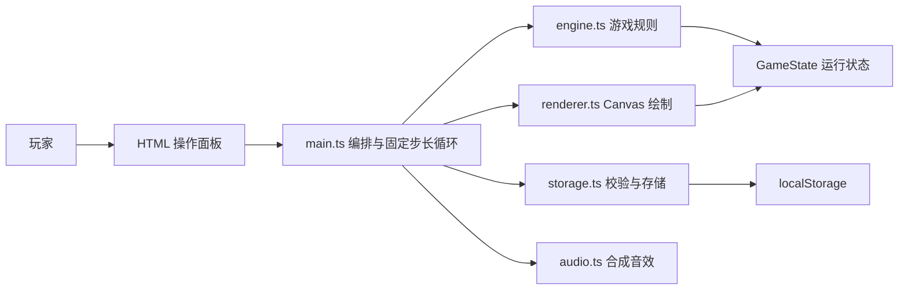
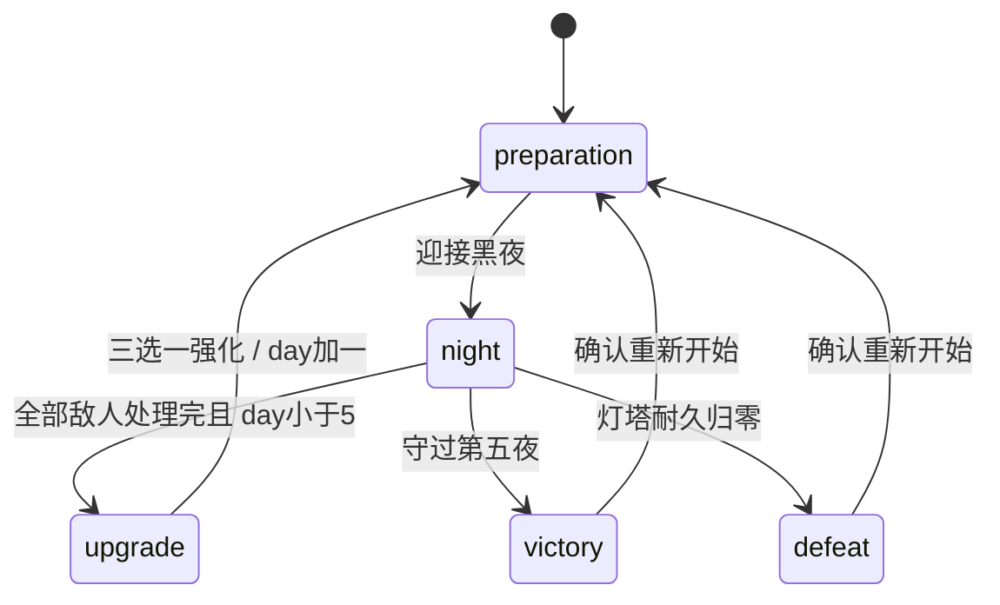

# 《最后一盏灯》软件设计文档

版本：0.1 · 日期：2026-10-22 · 对应需求：01-requirements.md v0.1

## 1. 架构与技术选择

采用 TypeScript + Vite + Canvas 2D，界面由 HTML/CSS 实现。游戏无需服务器即可运行，适合先验证核心循环并以静态文件部署。规则层不访问 DOM、本地存储或真实时钟，减少规则与界面的耦合。当前无数据库，后续如课程要求可在存储接口外增加服务端适配层。

## 2. 模块职责

| 模块 | 职责 | 不承担的职责 |
| --- | --- | --- |
| game/data.ts | 地图、路径、建造点、设施、敌人与强化配置 | 页面事件 |
| game/types.ts | 运行状态、枚举联合与接口 | 状态修改 |
| game/engine.ts | 创建新局、命令处理、战斗推进、胜负、种子随机数 | 渲染与存储 |
| game/storage.ts | 版本化序列化、结构与语义校验、浏览器存储失败处理 | 游戏平衡 |
| ui/renderer.ts | Canvas 地图、敌人、设施、光效与射程预览 | 战斗伤害判定 |
| ui/audio.ts | Web Audio 合成短音，音量与静音 | 资源加载 |
| ui/dom.ts | 局部协调生成的页面节点，保留同一操作按钮的身份与焦点 | 接收任意外部 HTML |
| main.ts | 页面布局、操作绑定、提示、弹窗、自动存档、模拟调度 | 内联战斗公式 |

## 3. 数据设计

| 对象 | 关键字段 | 约束 |
| --- | --- | --- |
| GameState | version、seed、day、phase、health、materials、energy、light | version=1；day 为 1..5 整数；资源非负；health 不高于最大耐久 |
| Tower | id、padId、kind、cooldown | 建造点唯一；类型必须存在于配置 |
| Enemy | id、kind、distance、health、slowUntil | 路径距离合法；类型与生命值合法 |
| Squad | id、spotId、cooldown、flash、aim | 防区唯一，最多三队；ID 与其他实体不冲突 |
| Survivors / Weapons | 专家 ID 数组、molotov / emp 库存 | 专家不重复、来自配置；武器库存为非负整数 |
| Battle | elapsed、spawned、total、spawnTimer、pulseCooldown | spawned≤total；计时非负；未刷完不得结算 |
| Modifiers | damage、range、efficiency、exploration、maxHealth | 仅通过已定义强化改变，恢复时检查有限数值与边界 |
| Statistics | kills、explorations、built、nightsSurvived、score | 非负整数 |
| SaveEnvelope | version、savedAt、state、settings | 单个 JSON，保存版本、状态与音量；体积和集合长度有限制 |

视觉效果计时与战斗实体一同保存，但不影响伤害规则；守夜成功或失败时清除射击和技能闪光。选中建造点、鼠标位置、弹窗和暂停标记不进入存档；载入夜间存档时自动暂停，等待玩家恢复。随机数种子进入存档，避免读取后改变事件结果。恢复早期 v1 存档时将零能源下残留的高亮模式归一为微光。

本地存储键：`last-light.save.v1`。本期不提供外部导入文件，但依然将浏览器中的数据视作不可信输入。字段、集合、关联、阶段、数值均校验，损坏存档不会直接传给规则层。

## 4. 内部接口

本期无 HTTP API。以下为代码模块接口；命令失败返回 `{ ok: false, message }`，成功返回 `{ ok: true, message }`，由页面显示反馈。

| 接口 | 输入 | 效果与主要限制 |
| --- | --- | --- |
| createGame(seed?) | 可选种子 | 返回独立新局 |
| explore(state, location) | 地点 ID | 白天且未探索；按种子产生事件与资源 |
| buildTower(state, kind, padId) | 设施类型、建造点 | 白天空位、足够材料；扣费后创建设施 |
| sellTower(state, padId) | 建造点 | 白天有设施；返还 60% 成本 |
| repairBeacon(state) | 当前状态 | 白天、非满血且材料足够；扣费恢复耐久 |
| setLight(state, level) | 三级亮度 | 在准备或战斗阶段调节；无能源时禁止高亮 |
| startNight(state) | 当前状态 | 白天进入夜间，初始化波次 |
| usePulse(state) | 当前状态 | 夜间、冷却结束、至少 12 能源；群体伤害 |
| recruitSquad(state, spotId) | 防区 ID | 白天空防区，45 材料；自动射击小队 |
| useWeapon(state, id) | 武器 ID | 夜间有敌人且有库存；消耗并施加群伤/灼烧/减速 |
| tick(state, dt) | 0..0.05 秒 | 推进一次模拟；其他阶段不更新 |
| chooseUpgrade(state, id) | 当前提供的强化 ID | 仅强化阶段且选项存在；应用后推进一天 |
| saveGame / loadGame | 状态、设置 / 无 | 返回带状态与错误提示的结果，不向页面抛存储异常 |

## 5. 状态机与战斗流程

`requestAnimationFrame` 驱动绘制。战斗采用 0.05 秒固定步长，2×速度增加步数，每帧积累时间有上限，避免切回页面时集中追赶。隐藏标签页、帮助和设置弹窗暂停推进。

每步顺序：计时与能源 → 按波次刷新敌人 → 区域灼烧 → 设施索敌并攻击 → 守备小队索敌并攻击 → 处理击杀与奖励 → 敌人移动与漏怪伤害 → 失败或清场结算。索敌优先选择最接近灯塔的射程内敌人。减速用模拟时间到期，暂停不消耗减速时长；范围攻击、武器与脉冲共享击杀清理，避免重复奖励。小队每队一个射击判定，渲染三个士兵；本期无独立士兵生命值或移动 AI。

路径以离散拐点构成，敌人记录沿路径行进的距离。渲染与规则调用同一位置函数，避免看起来进入射程却无法被攻击。

## 6. 界面设计

桌面：顶部品牌与设置；第二行资源；主体左侧地图、阶段信息与灯光操作，右侧探索/强化和设施卡；底部事件日志。夜间突出波次、暂停与脉冲；终局展示统计和重开。

窄屏：上下排列，地图按比例缩放，操作区域不低于常用触摸尺寸。建造点额外提供带编号的 HTML 按钮，支持键盘与辅助技术；Canvas 本身不能替代完整的屏幕阅读器战斗体验，此为当前可访问性限制。

视觉采用深蓝灰、暖琥珀、青绿色区分灯塔、设施与敌人；关键状态同时有文字，不仅依赖颜色。使用系统字体与代码绘图，无外部素材请求。

战斗数字与按钮状态以局部 DOM 更新呈现，不在每次计时变化时替换整个面板，避免键盘焦点丢失和按下/松开期间点击中断。能源按可用整数向下显示；不足 1 点但仍有余量时显示 `<1`，避免显示足够 12 点实际却不足以释放脉冲。

## 7. 异常与非功能设计

- 无效阶段命令、无效 ID、资源不足：规则层拒绝，不部分扣费；页面提示。
- 存档损坏、版本不兼容：拒绝加载，明确提示后新建，保留游戏可用性。
- 存储被禁用或空间不足：捕获异常，提示仅本次有效，不中断游戏。
- 夜间每 3 秒及关键操作后保存；浏览器关闭最多可能损失约 3 秒战斗进度，`pagehide` 尝试补存不作为保证。
- 无音频能力：静默降级；默认音效关闭，用户主动启用后创建音频上下文。
- 部署为相对路径静态资源，无密钥；构建脚本使用 `--base=./` 支持仓库子路径。

## 8. 需求追踪与验证

| 需求 | 设计落点 | 验证 |
| --- | --- | --- |
| FR-01、FR-07、FR-08 | 状态机、主界面终局与重开 | 规则测试、完整五夜模拟、浏览器操作 |
| FR-02、FR-03、FR-06 | 原子命令与资源约束 | 规则边界测试 |
| FR-04、FR-05 | 配置、路径、固定步长战斗 | 亮度/减速/击杀/漏怪测试 |
| FR-09、FR-11 | 页面暂停编排、按钮与响应式样式 | 浏览器测试与桌面/窄屏截图 |
| FR-10、NFR-03、NFR-06 | 存档校验与异常降级 | 存档往返、损坏、禁用存储测试 |
| FR-12、FR-13、FR-14 | 探索掉落、专家 ID 与被动能力、小队实体、特殊武器命令 | 首次救援、队长增伤、医生修复、持续伤害/减速、浏览器救援与部署 |
| NFR-01、NFR-02 | 静态构建与独立规则层 | 类型检查、生产构建、Node 测试 |
